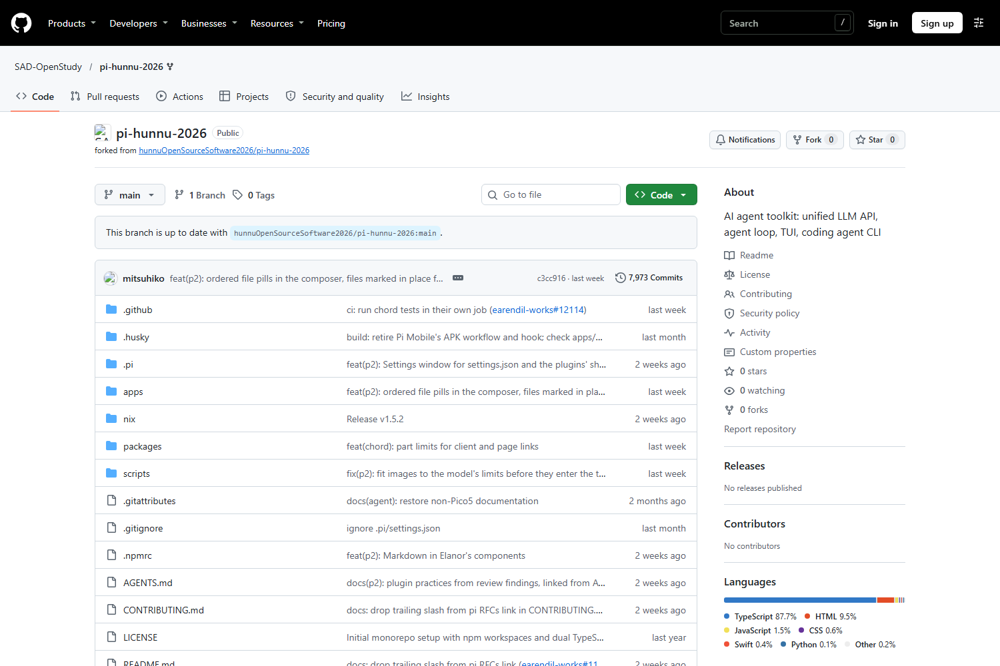
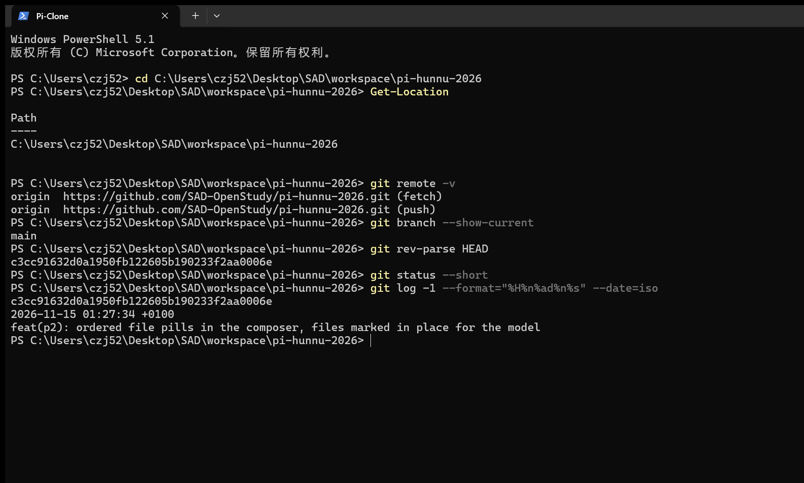
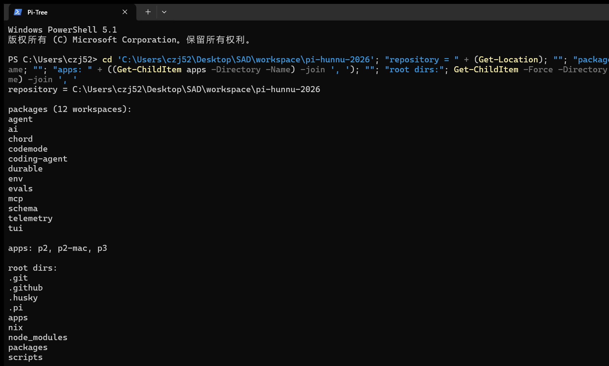
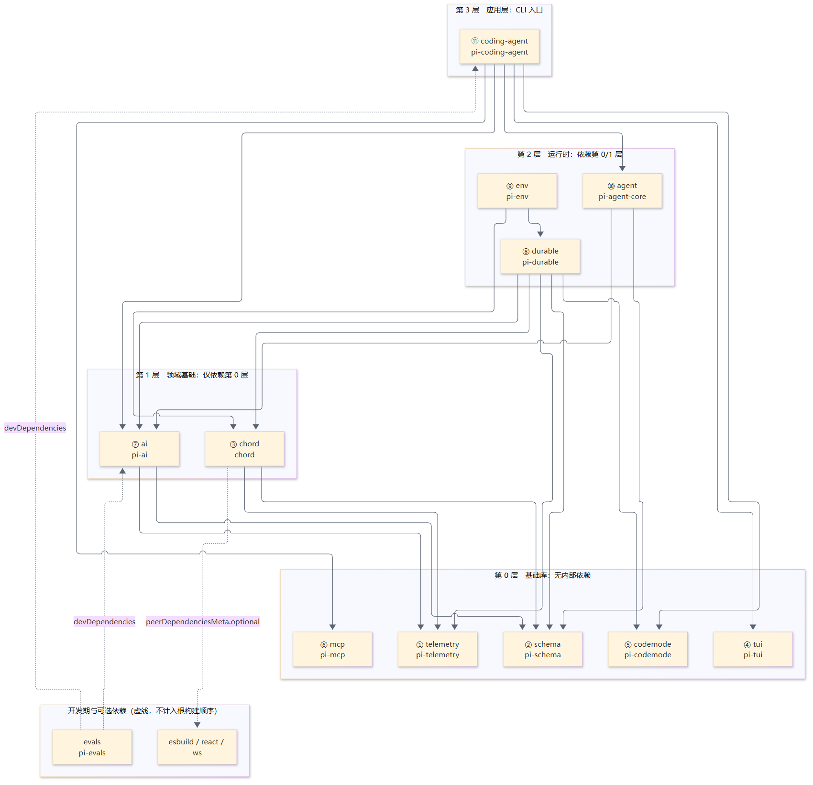
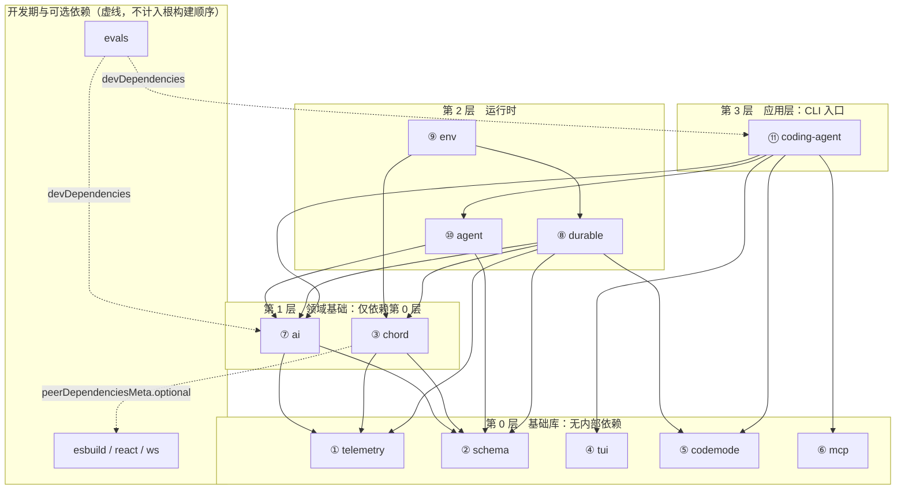
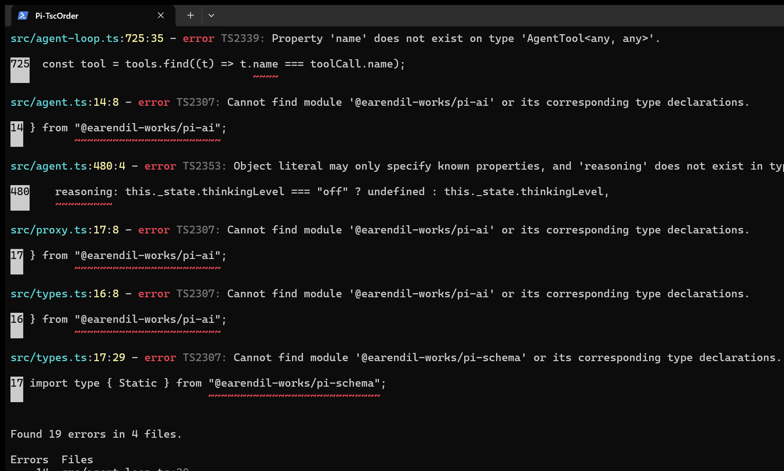

# 实践课2：组织建仓与 Pi Agent 源码分析

- 姓名：陈智杰　GitHub：[@czj-daniel-knox](https://github.com/czj-daniel-knox)
- 小组组织：`SAD-OpenStudy`　小组代码仓库：<https://github.com/SAD-OpenStudy/pi-hunnu-2026>
- 实际 clone 地址：<https://github.com/SAD-OpenStudy/pi-hunnu-2026.git>
- 源码版本：`c3cc91632d0a1950fb122605b190233f2aa0006e`（`main`，2026-11-15）
- 本地路径：`C:\Users\czj52\Desktop\SAD\workspace\pi-hunnu-2026`（全英文路径）
- 本人重点分析模块：**`ai`、`agent`、`coding-agent`**（CLI 主链路上的三层）
- 报告日期：2026-11-23

---

## 0 结论速览

1. **源码来源可核验**：`origin` 指向小组组织仓库而不是教师仓库，分支 `main`，HEAD 为 `c3cc91632d0a1950fb122605b190233f2aa0006e`，`git status --short` 为空。
2. **构建清单与作业表格一致**：根 `package.json` 的 `scripts.build` 依次构建 11 个包，正好是作业表格列出的 `telemetry … coding-agent`。
3. **仓库比表格多出内容**：`packages/` 下还有第 12 个 workspace `evals`，另有 `apps/p2`、`apps/p2-mac`、`apps/p3`；它们都不在根构建序列里，原因见 §2.3。
4. **根构建只做“调度”**：`npm run build` 读的是根 `package.json` 的 `scripts.build`，内容是 11 段 `cd <包> && npm run build`；每个包具体编译什么，由该包自己的 `package.json` 与 `tsconfig.build.json` 决定。
5. **构建顺序是人工排的近似拓扑序**：大体“被依赖者先构建”，但 `tui`、`codemode`、`mcp` 没有任何内部依赖却排在中间，说明**相邻构建的模块不一定互相依赖**（§5.2 有反例与实验）。
6. **依赖可分成 4 层**：L0 基础库（`telemetry`/`schema`/`tui`/`codemode`/`mcp`）→ L1 领域基础（`chord`/`ai`）→ L2 运行时（`durable`/`env`/`agent`）→ L3 应用（`coding-agent`）。

---

## 1 源码获取

### 1.1 小组组织中的 fork

小组已完成课程仓库 fork。仓库信息经 GitHub API 与仓库页面核对：

| 项目 | 值 |
|---|---|
| 仓库全名 | `SAD-OpenStudy/pi-hunnu-2026` |
| 类型 | fork（`fork: true`） |
| 父仓库 | `hunnuOpenSourceSoftware2026/pi-hunnu-2026` |
| 默认分支 | `main` |
| 可见性 | public |



*图1　组织仓库页面。页面顶部的 `forked from hunnuOpenSourceSoftware2026/pi-hunnu-2026` 与仓库归属 `SAD-OpenStudy` 同时可见，可证明“确实建在小组组织下、确实来自课程仓库”。*

### 1.2 下载源码

```powershell
git clone --branch main https://github.com/SAD-OpenStudy/pi-hunnu-2026.git
cd pi-hunnu-2026
```

- 实际 clone 地址：`https://github.com/SAD-OpenStudy/pi-hunnu-2026.git`（作业要求在 Issue 中以文本给出，此处同样以文本记录）
- 目标目录事先不存在，未覆盖任何已有目录。

### 1.3 确认源码来源与版本

```powershell
Get-Location
git remote -v
git branch --show-current
git rev-parse HEAD
git status --short
```

| 检查项 | 实际输出 | 说明 |
|---|---|---|
| `Get-Location` | `C:\Users\czj52\Desktop\SAD\workspace\pi-hunnu-2026` | 全英文路径，避免后续构建工具踩中文路径 |
| `git remote -v` | `origin https://github.com/SAD-OpenStudy/pi-hunnu-2026.git (fetch/push)` | 指向**小组组织**仓库，不是教师仓库 |
| `git branch --show-current` | `main` | 与作业要求一致 |
| `git rev-parse HEAD` | `c3cc91632d0a1950fb122605b190233f2aa0006e` | 完整提交号，记录进报告 |
| `git status --short` | （无输出） | 工作区干净，没有本地改动污染分析对象 |

提交标题：`feat(p2): ordered file pills in the composer, files marked in place for the model`（2026-11-15 01:27:34 +0100）。



*图2　S1 截图：五条命令的真实输出，可同时证明“源码已落到本地”和“来源/版本正确”，仅打开网页不能证明这一点。*

### 1.4 源码目录

仓库根目录是 npm workspaces 单仓（monorepo）：

```text
pi-hunnu-2026/
├─ package.json          根工作区配置与 build 调度脚本
├─ tsconfig.base.json    各包 tsc 编译的公共基线
├─ tsconfig.json         全仓类型检查（noEmit，paths 指向 src）
├─ pi-test.bat / .ps1    直接运行 src 源码的入口
├─ scripts/              构建与校验脚本（打包、复制产物、依赖检查等）
├─ packages/             12 个 workspace 包（表格中的 11 个 + evals）
│  ├─ telemetry  schema  chord  tui  codemode  mcp
│  ├─ ai  durable  env  agent  coding-agent
│  └─ evals
└─ apps/                 3 个应用（p2、p2-mac、p3），不在根构建序列中
```



*图3　源码目录截图：根目录文件与 `packages/` 子目录清单。*

---

## 2 仓库如何组织构建

### 2.1 工作区声明

根 `package.json`：

```json
"workspaces": [
  "packages/*",
  "apps/*",
  "packages/chord/test/examples/61-tutorial",
  "packages/coding-agent/examples/extensions/with-deps",
  "packages/coding-agent/examples/extensions/custom-provider-anthropic",
  "packages/coding-agent/examples/extensions/gondolin"
]
```

`packages/*` 与 `apps/*` 是主体，后面四条是示例/测试用的子工作区（也各自带 `package.json`）。根依赖只在根安装一次，所以后续所有命令都在仓库根执行。

### 2.2 根构建脚本的实际内容

`scripts.build` 是一条由 `&&` 串联的长命令，展开后是 11 步：

| 次序 | 目录 | 命令 |
|---:|---|---|
| 1 | `packages/telemetry` | `npm run build` |
| 2 | `packages/schema` | `npm run build` |
| 3 | `packages/chord` | `npm run build` |
| 4 | `packages/tui` | `npm run build` |
| 5 | `packages/codemode` | `npm run build` |
| 6 | `packages/mcp` | `npm run build` |
| 7 | `packages/ai` | `npm run build` |
| 8 | `packages/durable` | `npm run build` |
| 9 | `packages/env` | `npm run build` |
| 10 | `packages/agent` | `npm run build` |
| 11 | `packages/coding-agent` | `npm run build` |

`build:offline` 与它唯一的差别是第 7 步换成 `npm --prefix packages/ai run build:offline`，其余 10 步完全相同。

根 `engines` 为 `"node": ">=22.19.0"`；本机 `node v24.18.0`、`npm 12.1.0`、`git 2.55.0`，满足要求。

### 2.3 与作业表格的差异说明

作业表格列了 11 个包，实测仓库有 12 个 `packages/*` 目录：

- **`evals`（`@earendil-works/pi-evals`）不在表格也不在构建序列中。** 它没有 `build` 脚本，只有 `eval`/`test`；依赖 `pi-ai`、`pi-coding-agent` 也是放在 `devDependencies` 里——它是“用构建产物去跑评测”的包，位于依赖链最末端，不参与编译，所以被排除在 `scripts.build` 之外。
- **`apps/p2`、`apps/p2-mac`、`apps/p3` 也不在构建序列中。** 三个 app 都没有 `build` 脚本，它们通过源码路径依赖 `packages/*`，属于演示/前端应用，不是 `pi` CLI 发布链的一部分。
- 其余 11 个包与表格完全一致，因此本文表格按 11 行整理；`evals` 与 `apps` 的关系画在依赖图的“开发期”分组里。

---

## 3 模块分析表

> 依赖列只列**内部包**（`@earendil-works/*`），依据是 `package.json` 的 `dependencies` 与 `src` 中的实际 `import`；第三方依赖不混入。
> “构建产物”一列以 `tsconfig.build.json` 的 `outDir: ./dist`、`rootDir: ./src` 为准：`tsc` 会把 `src` 下每个 `.ts` 镜像输出为 `dist` 下同名 `.js` + `.d.ts` + `.js.map` + `.d.ts.map`。

| 子文件夹 | 代码主要实现什么功能 | 本模块 build 执行什么、生成什么 | 直接依赖哪些内部模块 | 依据文件或代码位置 |
|---|---|---|---|---|
| `telemetry` | 与厂商无关的遥测契约：`TelemetryContext`/`TelemetrySpan`（回调式、无全局当前 Span）、计数器/上下计数器/直方图与带类型的指标 schema、跨进程传播与 span link；提供 `NOOP_TELEMETRY_CONTEXT`、`InMemoryTelemetryContext` 参考实现和 testing 一致性工具。**不含 exporter，也不绑定任何后端**，OpenTelemetry/Sentry 等由使用方自己写适配器。 | `tsc -p tsconfig.build.json`：按 `tsconfig.base.json`（ES2024、Node16、`declaration`/`declarationMap`/`sourceMap`）编译 `src/**/*.ts` 到 `dist`。产物：`dist/index.js`、`dist/render.js`、`dist/testing/index.js` 及对应 `.d.ts`（对外入口由 `exports` 的 `.`/`./render`/`./testing` 声明）。 | 无（`dependencies` 为空，源码中无任何 `@earendil-works/*` 导入） | `packages/telemetry/package.json`（`scripts.build`、`exports`）、`tsconfig.build.json`、`src/index.ts`、`src/memory.ts`、`src/metrics.ts`、`src/noop.ts`、`src/render.ts`、`src/testing/` |
| `schema` | 无 `eval` 的 JSON Schema 构建器与校验器：schema 只编译一次成普通闭包，之后按值校验；支持 draft 2020-12 与 draft 7；错误以 JSON Pointer 报告；`formats`（email/uuid/date-time/ipv4…）作为可选第二入口，不进主包。 | `tsc -p tsconfig.build.json`。产物：`dist/index.js`、`dist/formats/index.js`（还有 `compiler`/`builders`/`checks`/`validator`/`resolver` 等模块的编译结果）及 `.d.ts`。运行时零依赖，`ajv`/`zod`/`typebox` 等只出现在 `devDependencies` 里用于对照测试。 | 无 | `packages/schema/package.json`、`tsconfig.build.json`、`src/index.ts`、`src/compiler.ts`、`src/builders.ts`、`src/checks.ts`、`src/validator.ts`、`src/formats/typebox/` |
| `chord` | 跨进程对象运行时：用 JSON Schema 描述“对象契约（contract）”，插件（facet）只声明、由 Chord 激活；对外只发引用（reference）；文档（document）+ 事务 + store、派生值（derive）、作业（job）、principal 隔离；插件热重载时 host 不停机。另有 HTTP、workers、插件构建、web/TUI surface、sqlite 存储、遥测写入等入口。 | `tsc -p tsconfig.build.json`，把约 300 个 `src` 文件编译到 `dist`，按 `exports` 暴露 20 多个入口（`.`、`./http`、`./workers`、`./plugins`、`./app`、`./web`、`./react`、`./tui`、`./sqlite`、`./telemetry-ingest` 等）。 | `pi-schema`（契约构造直接复用其 builder）、`pi-telemetry`（span/metric） | `packages/chord/package.json`（`dependencies`、`peerDependencies`、`peerDependenciesMeta`、`exports`）、`src/contracts/schema.ts`（`import … from "@earendil-works/pi-schema"`）、`src/telemetry-ingest/`、`src/telemetry-sqlite/`、`docs/design.md` |
| `tui` | 终端 UI 框架：主屏/备用屏两套渲染器、差分渲染（只重绘变化行）、CSI 2026 同步输出防闪烁、括号粘贴、鼠标/滚轮、Kitty/iTerm2 内联图片；自带 Text/Editor/Markdown/SelectList/SettingsList/Image 等组件与键绑定、模糊匹配、Oklab 配色。 | `npm run build` 只跑 `tsc -p tsconfig.build.json`，`include` 为 `src/**/*`，产物是 `dist` 下的 JS + `.d.ts` + map。**原生 N-API 修饰键模块不在 `build` 内**：由 `build:native:win32`（`node native/win32/build.mjs`，调 MSVC/MinGW 编译 C 源）、`build:native:darwin`、`build:native:linux`（`build.sh` + Xcode/cc）单独生成 `native/*/prebuilds/*.node`。 | 无内部包；第三方为 `get-east-asian-width`、`marked`、`marked-cjk-friendly` | `packages/tui/package.json`（`scripts.build`、`build:native:*`、`files`）、`tsconfig.build.json`、`src/tui.ts`、`src/tui-main-screen.ts`、`src/tui-alt-screen.ts`、`src/components/`、`native/win32/build.mjs` |
| `codemode` | 在 QuickJS（编译成 WebAssembly）沙箱里执行“模型写出来的 JavaScript”：脚本能碰到的唯一能力是注入的 `tools`，嵌套的工具调用不会进入 LLM 上下文，只有脚本输出/返回值回模型；支持 Node/Bun 的 worker 线程沙箱、Cloudflare Durable Object 沙箱和 inline 沙箱，是 CLI 内置 `codemode` 工具的实现。 | `tsc -p tsconfig.build.json`；`files` 里额外把 `src/cloudflare-modules.d.ts` 作为环境声明纳入编译。产物：`dist/index.js`、`dist/portable.js`、`dist/runtime/worker.js`、`dist/runtime/vm.js` 等及 `.d.ts`。 | 无内部包（运行时依赖仅 `quickjs-wasi`） | `packages/codemode/package.json`、`tsconfig.build.json`、`src/index.ts`、`src/runtime/{vm,worker,inline,remote,execution}.ts`、`src/portable.ts`、`src/wasm.ts` |
| `mcp` | 独立的 Model Context Protocol 客户端：与传输无关的客户端核心 + stdio / Streamable HTTP / pipe / 内存测试四种传输，JSON-RPC 协议层、工具列表与调用、OAuth（发现、loopback、令牌）、工具输出长度限制。**刻意不依赖官方 MCP SDK 和其它 pi 包。** | `tsc -p tsconfig.build.json`。产物：`dist/index.js`、`dist/oauth/index.js`、`dist/testing/index.js` 及各协议/传输模块的 JS + `.d.ts`。 | 无内部包（运行时依赖仅 `cross-spawn`） | `packages/mcp/package.json`、`src/client.ts`、`src/protocol/jsonrpc.ts`、`src/transports/{stdio,streamable-http,pipe,in-memory}.ts`、`src/oauth/` |
| `ai` | 统一 LLM API：多家 provider 的工厂与模型目录（chat/image/classifier）、鉴权解析（API Key / OAuth / Bedrock）、token 与费用统计、工具调用参数校验、流式与 partial JSON 解析、会话上下文持久化与跨模型交接。 | `build` = `generate-models` + `build:offline` 两步。①`generate-models` 执行 `catalog/generate.ts --strict`：从 models.dev / OpenRouter / Vercel AI Gateway 等上游拉模型目录，写出 `src/providers/data/<provider>.json`（被 gitignore）与已提交的 `*.models.ts` 包装；**首次构建需要联网**。②`build:offline` = `check:model-data` → `tsc -p tsconfig.build.json` → 清空 `dist/providers/data` → 把 `src/providers/data` 复制到 `dist/providers`。 | `pi-schema`（工具参数/JSON 校验）、`pi-telemetry` | `packages/ai/package.json`（`scripts.build`/`build:offline`）、`catalog/README.md`、`catalog/generate.ts`、`catalog/sources/models-dev.ts`、`src/api/`（20+ 个 provider API 适配器）、`src/providers/`、`src/auth/` |
| `durable` | 持久化 agent harness（实验性）：会话、模型轮次、工具调用与自定义状态**先提交到存储再展示**，进程中途死掉后重开存储可续跑；“文档”状态基于 chord 事务，`storage/*` 提供 jsonl / sqlite / indexeddb / memory 多种后端，另含 tools、tool-search、codemode 集成、图片处理与环境抽象。 | `tsc -p tsconfig.build.json`。注意它的 `paths` 把 `@earendil-works/chord*` 和 `@earendil-works/pi-ai` 指向 `../chord/dist/*.d.ts`、`../ai/dist/index.d.ts`——**必须先在 chord/ai 构建出声明文件**，否则类型解析失败。产物：`dist/index.js`、`dist/env/index.js`、`dist/storage/sqlite/index.js`、`dist/harness/*` 等及 `.d.ts`。 | `chord`、`pi-ai`、`pi-codemode`、`pi-schema`、`pi-telemetry` | `packages/durable/package.json`、`tsconfig.build.json`（`paths`）、`src/harness/`、`src/storage/`、`src/documents.ts`、`src/codemode/` |
| `env` | 远程执行环境：让 Durable 的工具跑在另一台机器（通常经 SSH），而 Durable worker、存储与凭据留在本地。`daemon/` 是一个 Rust 小程序（stdin/stdout 帧协议，做文件操作与命令），`RemoteExecutionEnv` 是 Durable `ExecutionEnv` 的 SSH 实现（含主机密钥指纹确认、按 SHA-256 部署 daemon）。 | `build` 只跑 `tsc -p tsconfig.build.json`（`paths` 指向 `../chord/dist/context`、`../durable/dist/env`）。**Rust daemon 不在 `build` 内**，由 `build:daemon`（`cargo build --manifest-path daemon/Cargo.toml --locked`）单独构建。产物：`dist/index.js` 等 9 个源文件对应的 JS + `.d.ts`。 | `chord`（context）、`pi-durable`（`/env` 接口） | `packages/env/package.json`、`tsconfig.build.json`、`src/remote-env.ts`、`src/ssh.ts`、`src/connection.ts`、`daemon/Cargo.toml`、`docs/protocol.md` |
| `agent` | 有状态 agent 核心：`Agent` 类 + agent loop（把模型流式输出转成工具调用，执行工具、回填结果、维护状态与事件流）、附件/状态管理、`streamFn` 抽象与代理（proxy）。是 CLI 真正的“会话循环”。 | `tsc -p tsconfig.build.json`；`paths` 把 `@earendil-works/pi-ai*` 指向 `../ai/dist/*.d.ts`，因此**必须在 ai 之后构建**。产物：`dist/agent.js`、`dist/agent-loop.js`、`dist/stream-fn.js`、`dist/proxy.js` 等 6 个源文件的 JS + `.d.ts`。 | `pi-ai`、`pi-schema` | `packages/agent/package.json`、`tsconfig.build.json`（`paths`）、`src/agent.ts`、`src/agent-loop.ts`、`src/stream-fn.ts`、`src/types.ts` |
| `coding-agent` | Pi CLI 本体：参数解析、交互式 TUI 模式与 RPC 模式、read/bash/edit/write 等工具、会话管理与压缩、认证/登录、扩展（extensions）、skills、主题、HTML 导出、内置 codemode 与 MCP 集成；`bin.pi` 指向打包后的 `dist/bundle/cli.js`。 | `build` = `build:unbundled` + `node ../../scripts/build-coding-agent-bundle.mjs`。①`build:unbundled`：`tsc -p tsconfig.build.json` → 给 `dist/cli.js`、`dist/rpc-entry.js` 加可执行位 → `copy-assets`（主题 json、图标 png、export-html 的 html/css/js、vendor）。②bundle：esbuild 以 `dist/cli.js`、`dist/index.js`、`dist/rpc-entry.js` 为入口打包到 `dist/bundle`（含 chunks、lazy OAuth/Bedrock 入口、codemode worker、图片缩放 worker），只有 `@silvia-odwyer/photon-node` 等少数包留在外部，并生成外层启动器 `dist/bundle/cli.js`。 | `pi-agent-core`（= `packages/agent`）、`pi-ai`、`pi-codemode`、`pi-mcp`、`pi-tui` | `packages/coding-agent/package.json`（`scripts.build`/`build:unbundled`/`copy-assets`、`bin.pi`）、`tsconfig.build.json`（`paths`）、`scripts/build-coding-agent-bundle.mjs`、`scripts/package-files.mjs`、`src/cli.ts`、`src/core/`、`src/modes/{interactive,rpc}/`、`src/extensions/{codemode,mcp,tool-search}/` |

**读表提示（容易误判的两点）：**

1. `tui`、`codemode`、`mcp`、`schema`、`telemetry` 的 `dependencies` 里**没有内部包**，但 `tui`/`schema` 的 `devDependencies` 很多（`vitest`、`ajv`、`zod`、`react` 等）。那是测试/对照用的，不参与发布产物的运行时。
2. `chord` 的 `esbuild`/`react`/`ws` 在 `peerDependencies` 且 `peerDependenciesMeta.optional = true`：宿主不装也能用，只有用到插件构建/React 绑定/WebSocket 链接时才需要。

---

## 4 模块层级与依赖关系图



*图4　自上而下依次是应用层 → 运行时 → 领域基础 → 基础库，最下方虚线框是开发期/可选依赖。箭头方向统一为“使用方 → 被依赖方”，所以箭头向下指向被依赖的模块；圆圈数字是根 `scripts.build` 的构建次序，可与 §2.2 对照。可编辑图源：[`diagrams/dependency-graph.mmd`](diagrams/dependency-graph.mmd)（Mermaid 文本，GitHub 上可直接渲染，也能导入 mermaid.live / draw.io 修改）。*



### 4.1 分层依据

分层只看两件事：**内部依赖的有无**和**依赖方向**，与构建顺序数字无关（数字只用来对照 §2.2）。

| 层 | 判定规则 | 成员 | 依赖数 |
|---|---|---|---|
| L0 | 内部依赖为 0，可独立构建、独立发布 | `telemetry`、`schema`、`tui`、`codemode`、`mcp` | 0 |
| L1 | 只依赖 L0 | `chord`（schema+telemetry）、`ai`（schema+telemetry） | 各 2 |
| L2 | 依赖 L0/L1，自身被应用或彼此复用 | `durable`（chord+ai+codemode+schema+telemetry）、`env`（chord+durable）、`agent`（ai+schema） | 5 / 2 / 2 |
| L3 | 唯一聚合所有层的应用入口 | `coding-agent`（agent+ai+codemode+mcp+tui） | 5 |

这样分层的直接好处：**层号越小越稳定**。L0 的 `schema`（~4.3k 行）和 `telemetry`（~1.5k 行）改动的爆炸半径最小；L3 的 `coding-agent` 有 ~71k 行、265 个源文件，任何包改接口都会波及它，所以它必须最后构建、最后验证。

### 4.2 开发依赖与可选依赖的区分

- **实线**（图4）：`dependencies` 或源码 `import` 能证实的硬依赖，发布包之间必须带上。
- **虚线 `evals`**：`pi-evals` 把 `pi-ai`、`pi-coding-agent` 放在 `devDependencies`，只在跑评测/文档生成时需要，不属于 CLI 运行时依赖链。
- **虚线 `esbuild/react/ws`**：`chord` 的 `peerDependencies` + `peerDependenciesMeta.optional`，由宿主按需提供，缺省时相应功能不可用而不是安装失败。
- **不画进图但属于同类的情形**：`tui` 的 `native/*` 预编译 `.node`、`env` 的 Rust daemon、`ai` 的模型目录数据，都由**独立脚本/外部工具**产生，不参与根 `npm run build` 的 Node 侧编译。这一点在 §5.1 展开。

---

## 5 三个问题

### 5.1 根目录与子模块中的 `npm run build` 分别读取什么配置、执行什么工作？

**根目录：只负责调度，不做编译。**

`npm run build` 在根执行时，npm 读取的只有根 `package.json` 的 `scripts.build`（外加 `engines` 之类的元数据，`engines` 只在版本不符时告警，不改变命令内容）。该脚本没有任何独立构建配置文件（没有 Makefile、没有 turbo/nx 配置），全部内容就是 11 段：

```text
cd packages/telemetry && npm run build
&& cd ../schema && npm run build
&& cd ../chord && npm run build
…
&& cd ../coding-agent && npm run build
```

因为用了 `&&`，**前一步非 0 退出就整体中止**，所以根构建成功等价于 11 个子构建依次成功；反过来说，只有某个子包成功不能代表整体成功。这也解释了实践课3 里“必须看最后退出码 + 产物 + 版本号三件套”的原因。

**子模块：读自己的 `package.json` + `tsconfig.build.json`，做真正的编译。**

以 11 个包中出现最多的形式为例（`telemetry`/`schema`/`chord`/`tui`/`codemode`/`mcp`/`durable`/`env`/`agent` 都是这一类）：

```jsonc
// packages/<pkg>/package.json
"scripts": { "build": "tsc -p tsconfig.build.json" }
```

```jsonc
// packages/<pkg>/tsconfig.build.json
{ "extends": "../../tsconfig.base.json",
  "compilerOptions": { "outDir": "./dist", "rootDir": "./src" },
  "include": ["src/**/*.ts"],
  "exclude": ["node_modules", "dist", "**/*.d.ts", "src/**/*.d.ts"] }
```

`tsconfig.base.json` 才是真正决定“怎么编译”的地方：`target: ES2024`、`module/moduleResolution: Node16`、`strict: true`、`declaration` + `declarationMap` + `sourceMap` + `inlineSources`。所以产物固定是 `dist/<相对 src 路径>.js`、`.d.ts`、`.js.map`、`.d.ts.map`；`package.json` 的 `exports` 再把 `types` 指向 `dist/*.d.ts`、`import` 指向 `dist/*.js`。

两个**特例**说明“子模块 build 读什么”不能一概而论：

| 包 | `build` 实际动作 | 读取的关键配置/脚本 | 产物 |
|---|---|---|---|
| `ai` | 先 `npm run generate-models`（`catalog/generate.ts --strict`，联网拉 models.dev 等上游目录），再 `build:offline`：`check:model-data` → `tsc` → 清 `dist/providers/data` → 复制 `src/providers/data` | `catalog/`（provider 定义、sources、families）+ `tsconfig.build.json` | `dist/**` + `dist/providers/data/*.json` |
| `coding-agent` | `build:unbundled`（tsc + `package-files.mjs executable` + `copy-assets`）→ `build-coding-agent-bundle.mjs`（esbuild 打包） | `tsconfig.build.json` + `scripts/build-coding-agent-bundle.mjs` 里的入口清单、`external` 白名单、banner、`target: node22.19` | `dist/**` + `dist/bundle/cli.js`（`bin.pi` 指向它）+ chunks |

也就是说：**`npm run build` 本身不“编译”任何东西，它只是按名字找到 `package.json` 里的脚本并执行；真正的编译器、目标、产物路径都写在项目配置里。** 同一句命令在不同项目里可以做完全不同的事（这里就有 tsc、esbuild、catalog 生成三种）。

### 5.2 构建顺序和模块依赖有什么关系？相邻构建的模块是否一定互相依赖？

**关系：大体一致，但只是“人工排出来的近似拓扑序”，不是工具算出来的严格拓扑序。**

一致的机制有三条，都能在代码里找到依据：

1. **声明文件解析**：`durable`、`env`、`agent`、`coding-agent` 的 `tsconfig.build.json` 里写了 `paths`，把内部包直接指向**上游的 `dist/*.d.ts`**（例如 `durable` 的 `"@earendil-works/chord": ["../chord/dist/index.d.ts"]`，`agent` 的 `"@earendil-works/pi-ai": ["../ai/dist/index.d.ts"]`）。上游没构建过，这些路径不存在，`tsc` 直接报找不到模块/类型。
2. **workspace 软链 + `exports` 指向 `dist`**：其余包（如 `ai` 依赖 `schema`/`telemetry`）走 `node_modules/@earendil-works/pi-schema` 软链，而它的 `exports.types` 指向 `./dist/index.d.ts`。没构建就没有 `dist`，类型解析同样失败。
3. **打包脚本的前置检查**：`scripts/build-coding-agent-bundle.mjs` 一开始就逐个 `existsSync` 检查 `dist/cli.js`、`dist/index.js`、`dist/rpc-entry.js` 以及 `ai/dist/api/bedrock-converse-stream.js` 等入口，缺失就抛 `Bundle input is missing: … Build the workspace packages first.`。这是把“必须先构建”写成了断言。

**反例：相邻构建 ≠ 互相依赖。** 按 §2.2 的顺序逐对检查：

| 相邻对 | 是否互相依赖 | 反证 |
|---|---|---|
| `schema` → `chord` | 是（chord 依赖 schema） | §3 表 |
| `chord` → `tui` | **否** | `tui` 的 `package.json` 无内部依赖，源码里也没有任何 `@earendil-works/*` 导入 |
| `tui` → `codemode` | **否** | 两者都是零内部依赖，互相不 import |
| `codemode` → `mcp` | **否** | `mcp` 明确“不依赖官方 MCP SDK 或其它 pi 包”，只依赖 `cross-spawn` |
| `mcp` → `ai` | **否** | `ai` 只依赖 schema/telemetry |
| `ai` → `durable` | 是（durable 依赖 ai） | `durable/package.json` + `tsconfig.build.json` 的 paths |
| `durable` → `env` | 是（env 依赖 durable） | `env` 依赖 `pi-durable/env` |
| `env` → `agent` | **否** | `agent` 只依赖 ai/schema，与 env/durable/chord 无关 |
| `agent` → `coding-agent` | 是（coding-agent 依赖 agent-core） | `coding-agent/package.json` |

统计一下：11 个包之间共 9 对“相邻”，其中 5 对**没有**依赖关系。三个零内部依赖的包（`tui`、`codemode`、`mcp`）被插在中间，说明顺序里还考虑了“先出基础库、后出 CLI”的可读性以及发布/调试习惯，而不是纯粹按依赖算。

另外有两个**不在顺序里**的旁证：`evals`（零 `build` 脚本）和 `apps/*`（零 `build` 脚本）压根不需要排；`tui` 的原生模块、`env` 的 Rust daemon、`ai` 的数据生成虽然也“先于使用”，却各自走独立脚本，进一步说明**根 `scripts.build` 只覆盖 Node 侧 tsc/esbuild 这条主链**。

**实验验证（本人实际跑过，不是推测）：** 装完依赖、尚未构建时，进入 `packages/agent` 单独执行 `npx tsc -p tsconfig.build.json --noEmit`：

```text
current = C:\...\pi-hunnu-2026\packages\agent
packages/ai/dist exists? False
src/agent.ts:14:8   - error TS2307: Cannot find module '@earendil-works/pi-ai' or its corresponding type declarations.
src/proxy.ts:17:8   - error TS2307: Cannot find module '@earendil-works/pi-ai' or its corresponding type declarations.
src/types.ts:16:8   - error TS2307: Cannot find module '@earendil-works/pi-ai' or its corresponding type declarations.
src/types.ts:17:29  - error TS2307: Cannot find module '@earendil-works/pi-schema' or its corresponding type declarations.
Found 19 errors in 4 files.
```



*图5　`packages/agent` 的 `tsconfig.build.json` 把 `@earendil-works/pi-ai` 指向 `../ai/dist/index.d.ts`，而上游还没构建，于是 `tsc` 报 TS2307 并连带报出一串类型错误。等 `ai`、`schema` 构建完成后再执行同一条命令即通过。这条实验把“构建顺序 → 声明文件 → 能否编译”的因果关系直接坐实。*

### 5.3 选一条至少三个模块的依赖路径，说明这些模块如何分工

**路径 A（本人重点）：`coding-agent` → `agent`（pi-agent-core）→ `ai` → `schema`（旁挂 `telemetry`）。**

| 层 | 模块 | 在这条链上的分工 |
|---|---|---|
| 应用 | `coding-agent` | 面向人的壳：解析参数（`src/cli/args.ts`）、决定交互式 TUI 还是 RPC（`src/modes/`）、注册 read/bash/edit/write 等工具、管理会话与压缩、处理登录与扩展；它把“用户这句话”变成一次 Agent 调用，并把流式结果渲染成终端界面。 |
| 运行时 | `agent` | 面向协议的核：`src/agent-loop.ts` 驱动“请求模型 → 收到 tool call → 执行工具 → 把结果回填 → 再次请求”的循环，`src/agent.ts` 维护状态与事件流。它不关心终端长什么样，也不关心模型是哪家。 |
| 接入 | `ai` | 面向模型的门：把统一的请求翻译成 Anthropic / OpenAI / Gemini / Bedrock 等各家的 API 调用（`src/api/*`），解析流式增量与工具参数 JSON，做鉴权、token/费用统计、模型目录查询（`catalog/`）。换模型只需要换这里的 provider，上面两层不用改。 |
| 校验 | `schema` | 面向数据的底座：用 `compile()` 把工具参数的 JSON Schema 编译成闭包校验器，`ai`/`agent` 用它检查模型吐出的参数是否合法、把错误定位到具体字段（JSON Pointer）。它不依赖任何人，所以排在最前构建。 |
| 观测 | `telemetry` | 与 `schema` 同层的旁挂：`ai`/`chord`/`durable` 通过显式传入的 `TelemetryContext` 记录 span 与指标，默认是 no-op，不装后端就没有额外开销。 |

一条请求在这条链上的顺序是：用户在 `coding-agent` 里输入 → `agent` 组 prompt 并调用 `ai` → `ai` 把工具 schema 交给 `schema` 校验/序列化 → 发到模型 → 模型返回 tool call → `ai` 解析增量 → `agent` 执行工具并回填 → `coding-agent` 渲染。**改界面只动 L3，换模型只动 `ai`，改校验/eval 只动 `schema`**，这就是分层带来的可替换性。

**对照路径 B：`coding-agent` → `tui`。** 只有两层：`tui` 提供差分渲染、组件和键绑定，`coding-agent` 的 `src/modes/interactive/` 用它画界面。这条路径说明“应用不一定依赖整条 L0–L2 链”：`tui` 零内部依赖，所以可以单独替换成别的 UI 库而不影响 agent/ai。

**对照路径 C：`durable` → `chord` → `schema`/`telemetry`。** 三层但性质不同：`durable` 负责“先落盘再展示”的持久化语义，`chord` 提供跨进程对象、事务文档与 store，`schema`/`telemetry` 提供契约描述与观测。这条路径是“服务端/长时任务”路线，与 CLI 的 A 路线并行。

---

## 6 本人重点分析模块与自述

- **重点分析：`ai`、`agent`、`coding-agent`**。三者构成 §5.3 的主路径，本人逐文件看过 `ai/src/api/`（provider 适配器与 lazy 入口）、`ai/catalog/`（模型目录生成）、`agent/src/agent-loop.ts`、`coding-agent/src/cli.ts` + `core/agent-session*.ts` + `modes/`，并核对了它们 `package.json`/`tsconfig.build.json` 的依赖声明与 `paths`。
- 其余 8 个包（`telemetry`、`schema`、`chord`、`tui`、`codemode`、`mcp`、`durable`、`env`）本人也独立核对了 README、`package.json`、入口源码与构建脚本，表格中的功能描述均来自实际源码而非包名直译；对不确定的地方（如 `chord` 的 peer 依赖是否必需、`env` 的 Rust daemon 是否参与构建）都回到配置/脚本确认后才写入。
- 表内所有“直接依赖”均以 `dependencies` + 源码 `import` 双重验证；仅出现在 `devDependencies` 的（`evals` → coding-agent/ai）在 §4.2 单独标出，未混入依赖图实线。

---

## 7 过程中的问题与处理

| 问题 | 现象 | 处理 |
|---|---|---|
| 直连 GitHub 网页/raw 失败 | 浏览器外抓取 `raw.githubusercontent.com` 报连接错误，无法直接读 Markdown | 改用 `git clone` 读仓库内容（git 协议可用），并核对 `git rev-parse HEAD` 与网页 API 一致 |
| 首次 `npm install` 日志混入 PowerShell 错误记录 | 用 `*>`/`2>&1` 重定向时，npm 的 stderr 被 Windows PowerShell 5.1 包装成 `NativeCommandError`，红字与真实错误难以区分 | 安装时不重定向，用 `Start-Transcript` 留原始记录，退出码单独用 `"EXIT=$LASTEXITCODE"` 打印，避免把警告误读成失败 |
| 报告用图的可编辑性 | 只用 PNG 无法二次修改 | 同时提交 Mermaid 文本 `diagrams/dependency-graph.mmd`，GitHub 可直接渲染，也能导入 mermaid.live / draw.io 编辑 |

---

## 8 附录：证据与命令清单

**截图索引（本报告 images/）**

| 文件 | 内容 | 对应要求 |
|---|---|---|
| `P2_S1_org_repo.png` | 组织仓库页面 + `forked from` 标注 | 组织仓库截图 |
| `P2_S2_clone_verify.png` | 当前目录、远端、分支、提交号、干净工作区 | S1 |
| `P2_S3_source_tree.png` | 仓库根目录与 `packages/` 12 个包 | 源码目录截图 |
| `P2_S4_tsc_order.png` | 未构建上游时单独编译 `agent` 失败的 TS2307 | §5.2 的因果验证 |
| `dependency-graph.png` | 模块层级与依赖关系图 | 依赖关系图 |
| `diagrams/dependency-graph.mmd` | 图源（Mermaid） | 可编辑图源 |

**关键命令**

```powershell
git clone --branch main https://github.com/SAD-OpenStudy/pi-hunnu-2026.git
cd pi-hunnu-2026
Get-Location; git remote -v; git branch --show-current; git rev-parse HEAD; git status --short
Get-ChildItem packages -Directory
```

**版本快照**

| 项 | 值 |
|---|---|
| 源码提交 | `c3cc91632d0a1950fb122605b190233f2aa0006e` |
| 分支 | `main` |
| Node.js / npm / git | v24.18.0 / 12.1.0 / 2.55.0 |
| 工作区包数 | `packages/` 12 个（含 `evals`）、`apps/` 3 个 |
