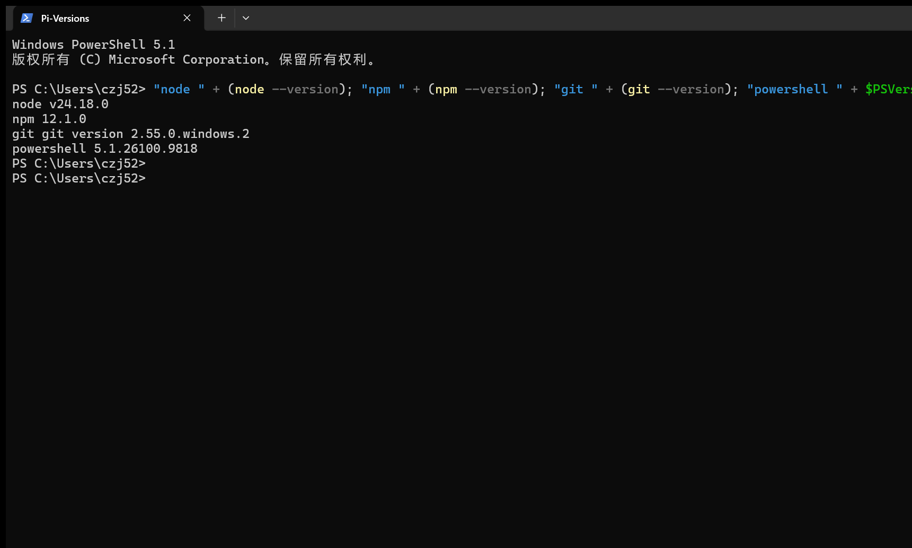
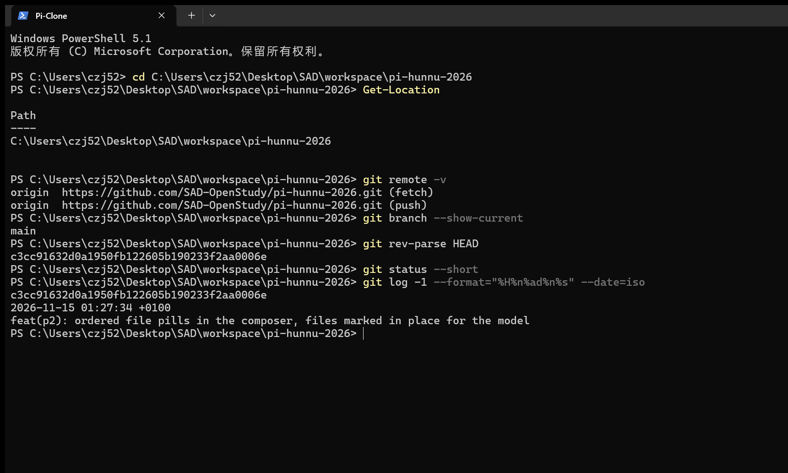
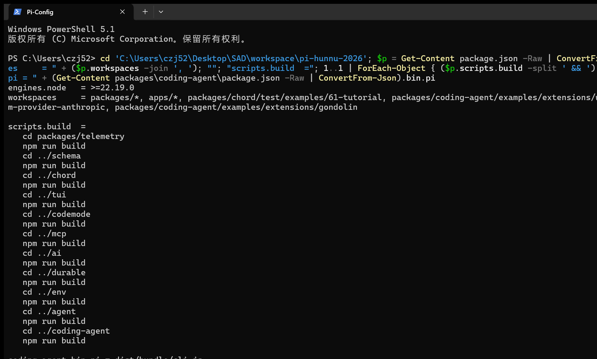
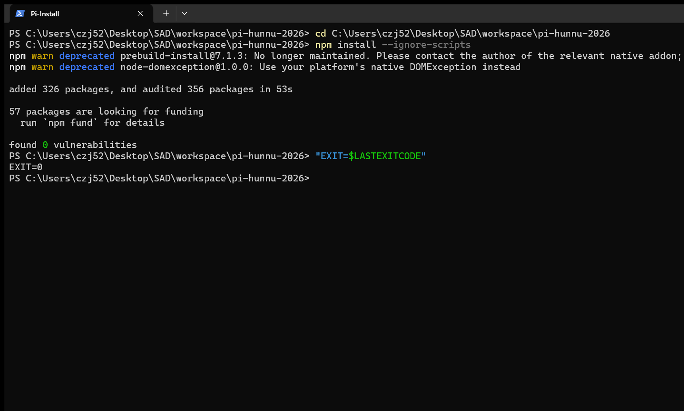
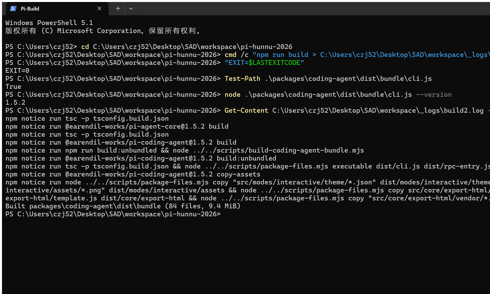
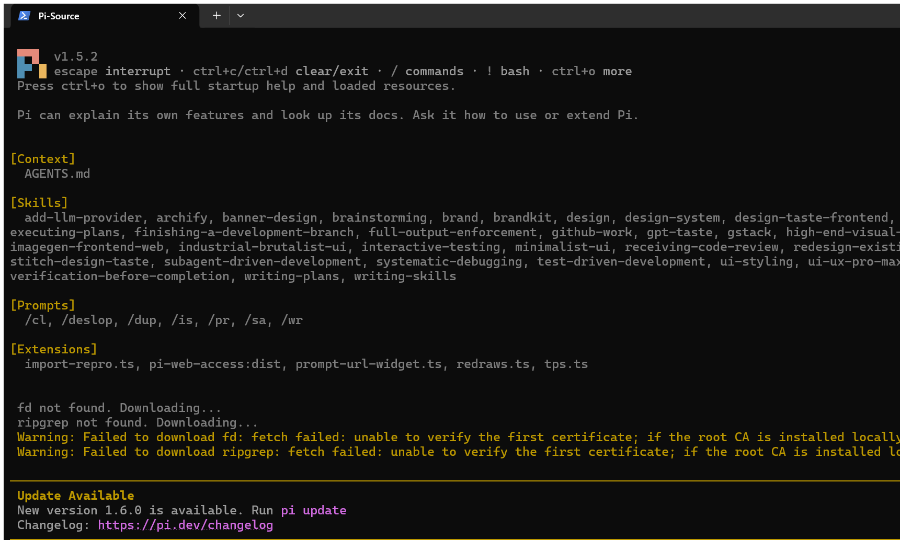
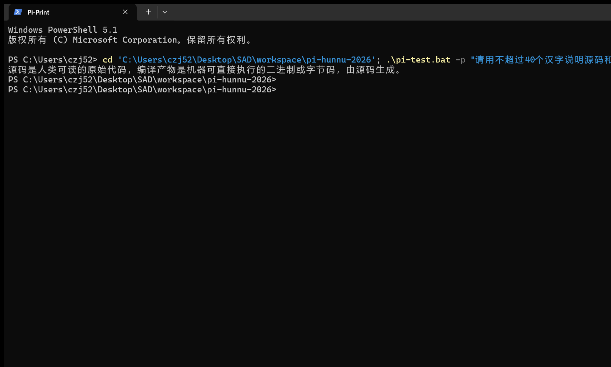
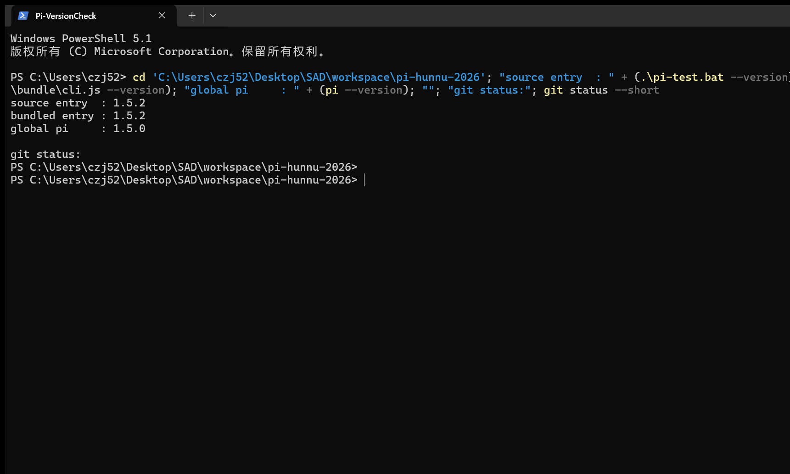

# 实践课3：Pi Agent 源码获取、依赖安装与本地编译

- 姓名：陈智杰　GitHub：[@czj-daniel-knox](https://github.com/czj-daniel-knox)
- 小组组织仓库（源码）：<https://github.com/SAD-OpenStudy/pi-hunnu-2026>
- 实际 clone 地址：<https://github.com/SAD-OpenStudy/pi-hunnu-2026.git>
- 源码版本：`c3cc91632d0a1950fb122605b190233f2aa0006e`（`main`）
- 本地路径：`C:\Users\czj52\Desktop\SAD\workspace\pi-hunnu-2026`（全英文路径）
- 环境：Node.js `v24.18.0`、npm `12.1.0`、git `2.55.0.windows.2`、Windows PowerShell `5.1.26100.9818`
- 报告日期：2026-11-23

---

## 0 结论速览

| 问题 | 结论 |
|---|---|
| 源码在哪里 | `C:\Users\czj52\Desktop\SAD\workspace\pi-hunnu-2026`，来自小组组织仓库，`origin` 已核对，HEAD = `c3cc916…` |
| 依赖装在哪里 | 仓库根的 `node_modules/`（npm workspaces，只装一次）；12 个内部包以 junction 形式链到 `packages/*` |
| 构建执行了什么 | 根 `npm run build` 依次进 11 个包跑各自的 `build`：10 个是 `tsc -p tsconfig.build.json`，`ai` 额外先联网生成模型目录，`coding-agent` 最后用 esbuild 打包 |
| 正在运行哪个版本 | 本地源码入口与 `dist/bundle/cli.js` 都是 **1.5.2**；第一次实践装到全局的 `pi` 是 **1.5.0**，两者可区分 |
| 构建是否成功 | `npm run build` 退出码 `0`；`packages/coding-agent/dist/bundle/cli.js` 存在；`node … --version` 输出 `1.5.2`；bundle `84 files, 9.4 MiB` |
| 安装是否成功 | `npm install --ignore-scripts` 退出码 `0`，`added 326 packages … found 0 vulnerabilities`（警告与错误见 §4.2） |

---

## 1 任务一　实验准备：检查开发工具（S1）



*图1　S1 截图：`node v24.18.0`、`npm 12.1.0`、`git 2.55.0.windows.2`、PowerShell 5.1。*

| 工具 | 实测版本 | 本次用途 | 与项目要求的关系 |
|---|---|---|---|
| Node.js | v24.18.0 | 运行 Pi、tsc、esbuild | 根 `package.json` 的 `engines.node` 是 `>=22.19.0`，满足；与课程建议的 Node.js 24 LTS 同系列 |
| npm | 12.1.0 | 安装依赖、执行 scripts | 随 Node 24 附带，未单独安装；项目没有锁定 npm 版本 |
| Git | 2.55.0.windows.2 | clone、版本核对；同时提供 Pi 需要的 Git Bash | 满足 |
| Windows PowerShell | 5.1.26100.9818 | 交互终端 | 见 §7.2：5.1 在重定向 npm 输出时会把 stderr 包装成错误记录 |

**为什么选 Node 24 而不是刚好 22：** 根项目只要求 `>=22.19.0`，但工作区里有的依赖（如 `@earendil-works/gondolin`）声明了更高的 Node 版本，旧环境用 Node 22 时出现过 `EBADENGINE` 警告。本次直接用 Node 24 LTS，安装日志里没有 `EBADENGINE`。

---

## 2 任务二　下载源码并确认版本（S2）

本次沿用实践课2 已 clone 的仓库（作业允许上次已做的步骤略过，但版本必须重新核对）：

```powershell
Get-Location
git remote -v
git branch --show-current
git rev-parse HEAD
git status --short
git log -1 --format="%H%n%ad%n%s" --date=iso
```



*图2　S2 截图：`origin` 指向小组组织仓库，分支 `main`，HEAD `c3cc91632d0a1950fb122605b190233f2aa0006e`，`git status --short` 无输出。*

| 检查项 | 结果 |
|---|---|
| 远端 | `https://github.com/SAD-OpenStudy/pi-hunnu-2026.git`（fetch/push 都是它） |
| 分支 | `main` |
| 提交 | `c3cc91632d0a1950fb122605b190233f2aa0006e`，2026-11-15 01:27:34 +0100，`feat(p2): ordered file pills in the composer, files marked in place for the model` |
| 工作区 | 干净（无输出） |

后续所有安装、构建、运行命令都在这个仓库根目录执行。构建前后都复查了 `git status --short`，仍然为空——`dist/`、`node_modules/`、`.artifacts/` 都在 `.gitignore` 里，构建不会污染工作区。

---

## 3 任务三　阅读配置，确认安装与编译的依据（S3）

### 3.1 README 的 Development 命令

`README.md` 的 Development 一节给出：

```bash
npm install --ignore-scripts  # 安装依赖，不跑生命周期脚本
npm run build                 # 先刷新模型数据，再构建全部包
npm run build:offline         # 复用已有模型数据，离网重建
npm run check                 # lint + 格式化 + 类型检查
./test.sh                     # 跑测试
./pi-test.sh                  # 直接运行源码版 pi
```

Windows 上对应 `pi-test.bat`（内部调用 `pi-test.ps1`）。这解释了为什么“构建”和“运行源码”是两个独立入口。

### 3.2 根 `package.json`：`engines` 与 `scripts.build`



*图3　S3 截图：从根 `package.json` 读出的 `engines.node = >=22.19.0`、workspaces 列表，以及被 `&&` 串起来的 11 段构建命令。*

- **Node 版本要求在哪里？** 在 `package.json` 的 `engines.node` 字段（`>=22.19.0`），不是写在 README 或 CI 里；各子包也各自声明了同一要求，npm 安装时会校验。
- **`npm run build` 的 11 段命令实际从哪里读取？** 从**根 `package.json` 的 `scripts.build`** 读出：它自己不含任何编译参数，只是 11 次 `cd <包> && npm run build`；每一段进入子包后，再由**该子包的 `package.json` `scripts.build`** 决定具体动作。

### 3.3 `packages/coding-agent/package.json`：入口与构建脚本

```jsonc
"bin": { "pi": "dist/bundle/cli.js" },
"scripts": {
  "build": "npm run build:unbundled && node ../../scripts/build-coding-agent-bundle.mjs",
  "build:unbundled": "tsc -p tsconfig.build.json && node ../../scripts/package-files.mjs executable dist/cli.js dist/rpc-entry.js && npm run copy-assets"
}
```

`bin.pi` 指向的**不是** `src/cli.ts`，而是打包后的 `dist/bundle/cli.js`；源码运行走的是仓库根的 `pi-test.bat`。

---

## 4 任务四　安装项目依赖（S4）

### 4.1 命令与结果

```powershell
npm install --ignore-scripts
```



*图4　S4 截图：`added 326 packages, and audited 356 packages in 53s`、`57 packages are looking for funding`、`found 0 vulnerabilities`，随后用 `"EXIT=$LASTEXITCODE"` 打出 `EXIT=0`。*

| 观察项 | 实际输出 | 含义 |
|---|---|---|
| 安装结果 | `added 326 packages, changed 4 packages, and audited 356 packages in 53s` | 依赖已落到根 `node_modules`；耗时 53 s（首次冷启动约 3 分钟，第二次命中 npm 缓存） |
| 警告 1 | `npm warn deprecated prebuild-install@7.1.3: No longer maintained…` | 某个原生模块的下载工具已停止维护，**不影响安装** |
| 警告 2 | `npm warn deprecated node-domexception@1.0.0: Use your platform's native DOMException instead` | 传递依赖已弃用，**不影响安装** |
| 审计 | `found 0 vulnerabilities` | 本次依赖树审计未报已知漏洞；这不等于“构建成功” |
| 退出码 | `EXIT=0` | 没有 `npm error`，命令成功 |

### 4.2 警告与错误的区分

- 上面两条都是 `npm warn`，属于“依赖维护状态提示”，命令仍然 `exit 0`；如果出现 `npm error`（例如 `EBADENGINE`、`ETARGET`、`ERR_SOCKET_TIMEOUT`）才是失败。
- `--ignore-scripts` 的作用是**跳过安装期的 `postinstall`/`prepare` 等生命周期脚本**，避免第三方包在安装时执行任意脚本，也避免 `canvas` 之类原生模块在本机编译失败。它不影响后面主动执行的 `npm run build`。
- 没有 `-g`：这是**项目内**安装，`node_modules` 在仓库根，不会把本地修改安装成全局 `pi`。全局 `pi` 仍是实践课1 装的 1.5.0（见 §6.3 的对比）。

### 4.3 依赖装在哪里

- 全部依赖在仓库根的 `node_modules/`（npm workspaces 会提升），根下约 226 个顶层条目；
- 12 个内部包不是下载的，而是 **junction 软链**：`node_modules/@earendil-works/pi-ai → packages/ai` 等，所以改 `packages/*/src` 立即对其它包生效；
- `openai@7.19.0` 因为版本与其它 workspace 冲突，被放在 `packages/ai/node_modules/`，属于正常的嵌套安装。

---

## 5 任务五　本地编译与构建产物验证（S5）

### 5.1 执行构建

```powershell
npm run build
```

本次构建实际耗时 **53 秒**（15:13:12 → 15:14:05，11 个包 + 模型目录生成 + esbuild 打包），退出码 `0`。



*图5　S5 截图：`EXIT=0`、`Test-Path .\packages\coding-agent\dist\bundle\cli.js` 输出 `True`、`node … cli.js --version` 输出 `1.5.2`，下方是构建日志最后 10 行（包含 `Built packages\coding-agent\dist\bundle (84 files, 9.4 MiB)`）。*

### 5.2 构建过程观察（对应实践课2 的分析）

构建日志按顺序出现 11 个包，和根 `scripts.build` 完全一致：

```text
pi-telemetry → pi-schema → chord → pi-tui → pi-codemode → pi-mcp
→ pi-ai → pi-durable → pi-env → pi-agent-core → pi-coding-agent
```

其中两处与“只会 tsc”不同：

1. **`pi-ai` 会联网**：先 `generate-models` 拉取 models.dev / OpenRouter 等上游模型目录（日志里逐行打印每个 provider 的 `N chat models, M image models, K classifier models`），生成 `src/providers/data/*.json`（本次 44 个 JSON）；再 `check:model-data` 输出 `Generated model data is valid.`，最后 `tsc` 并把数据复制到 `dist/providers`。**这一步不是下载大模型权重**，只是下载模型名称/价格/能力等目录数据。
2. **`pi-coding-agent` 会打包**：`tsc` 产出 `dist/*.js` 后，esbuild 把入口打进 `dist/bundle`，最终 `84 个文件、9.4 MiB`，并生成 160 字节的启动器 `dist/bundle/cli.js`（`bin.pi` 指向它）。

### 5.3 产物检查

```powershell
Test-Path .\packages\coding-agent\dist\bundle\cli.js   # True
node .\packages\coding-agent\dist\bundle\cli.js --version   # 1.5.2
```

三点必须同时成立才算构建成功：**退出码 0**、**入口文件存在**、**运行入口能得到版本号**。只看到某个子包成功、或只看到版本号，都不能代替整体验证。

### 5.4 后续重新构建

首次构建已把模型数据写进 `src/providers/data/`，之后改代码可以用：

```powershell
npm run build:offline
```

它与 `npm run build` 只在第 7 步不同（`ai` 用 `build:offline`，跳过联网生成、直接校验已有数据）。本次没有把它当作首次构建的替代，因为首次必须先把数据准备好。

---

## 6 任务六　启动本地源码版本并完成一次会话（S6）

### 6.1 源码入口是什么

```powershell
.\pi-test.bat --version   # 1.5.2
```

`pi-test.bat` → `pi-test.ps1` → `node --import <repo>/packages/coding-agent/src/experimental/source-resolver.ts <repo>/packages/coding-agent/src/cli.ts`。也就是说，它用 Node 的 loader 直接加载 **TypeScript 源码**，不经过 `dist`。

### 6.2 启动交互界面

```powershell
.\pi-test.bat
```

首次启动会询问是否信任项目目录（这是 Pi 的安全机制，允许加载项目级 `.pi` 配置/扩展）；选择 `Trust` 后进入界面：



*图6　S6 截图之一：`.\pi-test.bat` 启动的 Pi，版本 `v1.5.2`，并加载了 `[Context] AGENTS.md`、`[Skills]`、`[Prompts]`、`[Extensions]`。图中还有两条 `fd`/`ripgrep` 下载失败的警告（见 §7.4）与 `Update Available` 提示（全局更新提示，与本次源码版本无关）。*

### 6.3 一次真实会话

在 TUI 中键入提示词后，本次改用同一条源码入口的**非交互模式**留证（原因见 §7.3）：

```powershell
.\pi-test.bat -p "请用不超过40个汉字说明源码和编译产物的区别。只回答问题，不修改文件。"
```



*图7　S6 截图之二：自己发出的提示词、`pi-test.bat` 命令与实际模型回复——“源码是人类可读的原始代码，编译产物是机器可直接执行的二进制或字节码，由源码生成。”*

### 6.4 如何确保运行的是本地源码



*图8　`source entry: 1.5.2`（`.\pi-test.bat`）、`bundled entry: 1.5.2`（`dist/bundle/cli.js`）、`global pi: 1.5.0`；`git status --short` 仍为空。*

三条证据：

1. **入口**：命令是 `.\pi-test.bat`，它执行的是 `src/cli.ts`，不是 PATH 里的 `pi`；
2. **版本**：本地源码/产物是 `1.5.2`（源码 `package.json` 的版本号），全局安装的是 `1.5.0`，两者能区分开；图6 的 TUI 也显示 `v1.5.2`；
3. **上下文**：图6 加载的 `[Context] AGENTS.md` 来自本次 clone 的仓库根目录，说明工作目录与源码树就是这一份。

如果直接输入 `pi`，启动的是实践课1 装的全局 1.5.0，无法证明运行的是刚编译的源码——这也是本次坚持用 `.\pi-test.bat` 的原因。

### 6.5 两个入口分别适合什么场景

| 入口 | 启动方式 | 适合场景 | 本机实测 |
|---|---|---|---|
| 源码入口 | `.\pi-test.bat`（node + source-resolver 直接跑 `src/cli.ts`） | 开发调试：改完 `src` 立即生效、可断点/加日志、不用等构建；但启动慢一些，依赖 `node_modules` 与 loader | 1.5.2 |
| 打包入口 | `node .\packages\coding-agent\dist\bundle\cli.js`（= `bin.pi`） | 验证“发布出去的东西”：单入口 + 代码分割、只有少量 external、更接近 `npm i -g` 后的形态；也用于分发 | 1.5.2 |
| 全局命令 | `pi` | 日常使用已发布版本，与源码无关 | 1.5.0 |

---

## 7 遇到的困难与解决（重点）

### 7.1 首次安装被中断，需要干净重来

第一次 `npm install` 在下载阶段耗时较长，中途被终止后留下半成品 `node_modules`。**处理**：确认那是本次新建的依赖目录后整体删除（`rd /s /q node_modules`），重新安装；没有删除或覆盖仓库里任何源码文件。重装后 `npm ls @earendil-works/pi-ai` 能正常解析，内部包都是 junction。

### 7.2 Windows PowerShell 5.1 会把 npm 的 stderr 包装成“错误”

一开始用 `npm install 2>&1 | Tee-Object log` 记录日志，结果 stderr 里的 `npm warn` 被 5.1 变成 `NativeCommandError` 错误记录，日志里出现 `+ CategoryInfo …` 和红色错误块，很容易误判成安装失败。**处理**：

- 安装/构建时**不把 npm 输出接管道**，改用 `Start-Transcript` 或在 `cmd /c "... > file 2>&1"` 里合并流，保留原始文本；
- 退出码单独用 `"EXIT=$LASTEXITCODE"` 打印并与日志分开判断。

这也是后来截图里 `EXIT=0` 单独占一行的原因。

### 7.3 Windows Terminal 在大量输出后停止刷新

`npm run build` 一次输出几百行（模型目录逐 provider 打印），在 Windows 的 conpty 里出现过终端画面停在半截、后面明明已经构建完成但窗口不再更新的情况，导致截图拿不到“最后一段输出”。**处理**：

- 把构建输出重定向到日志：`cmd /c "npm run build > build.log 2>&1"`，终端只显示少量行；
- 构建结束后再用 `Get-Content build.log -Tail 10` 把最后一段贴回屏幕，配合 `EXIT`、`Test-Path`、`--version` 一起截图（即图5）；
- 这样做还有个好处：日志可回查，不必依赖截图里的滚动内容。

同一原因也影响了交互界面：Pi 首次启动会显示 1.5.2 的完整 changelog，输出量很大，TUI 画面卡住、按键看不到反馈。**处理**：把 `~/.pi/agent/settings.json` 的 `lastChangelogVersion` 设为 `1.5.2` 跳过 changelog，重新启动后进入正常界面（图6）；实际提问与回复改用 `-p` 非交互模式留证（图7）。

### 7.4 `fd` / `ripgrep` 下载失败（证书校验）

启动源码版 Pi 时出现：

```text
fd not found. Downloading...
ripgrep not found. Downloading...
Warning: Failed to download fd: fetch failed: unable to verify the first certificate
Warning: Failed to download ripgrep: fetch failed: unable to verify the first certificate
```

原因是本机网络对 HTTPS 做了中间代理，Node 的 fetch 找不到本地根证书，Pi 自动补装 `fd`/`ripgrep` 失败。**影响**：只影响依赖这两个外部搜索工具的搜索类功能，**不影响**启动、模型调用与本次会话；**处理**：记录现象，不强行改系统证书；需要搜索时可在 Git Bash 里用系统自带 `grep` 或临时配置 `NODE_EXTRA_CA_CERTS`。

### 7.5 `pi update` 提示 1.6.0

界面底部提示 `New version 1.6.0 is available. Run pi update`。这是**全局 npm 包**的更新提示，本次运行的是本地源码 1.5.2，**没有执行** `pi update`，否则会覆盖实践课1 的全局环境、干扰“运行的是本地源码”这一结论。

---

## 8 附录

### 8.1 截图索引

| 文件 | 内容 | 对应要求 |
|---|---|---|
| `P3_S1_versions.png` | node / npm / git / PowerShell 版本 | S1 |
| `P3_S2_clone.png` | 当前目录、远端、分支、提交号、干净工作区 | S2 |
| `P3_S3_config.png` | `engines.node`、`workspaces`、`scripts.build` 11 步 | S3 |
| `P3_S4_install.png` | 安装结束输出、警告、0 漏洞、`EXIT=0` | S4 |
| `P3_S5_build.png` | 构建日志末尾、`EXIT=0`、入口存在、`--version` | S5 |
| `P3_S6a_pi_start.png` | 源码版 Pi 启动界面（v1.5.2） | S6 |
| `P3_S6b_pi_reply.png` | 提示词与实际模型回复 | S6 |
| `P3_S6c_versions.png` | 源码 / 打包 / 全局三个入口版本对比 | 报告说明 |

### 8.2 命令清单

```powershell
node --version; npm --version; git --version
git clone --branch main https://github.com/SAD-OpenStudy/pi-hunnu-2026.git
cd pi-hunnu-2026
git remote -v; git branch --show-current; git rev-parse HEAD; git status --short
npm install --ignore-scripts
npm run build
Test-Path .\packages\coding-agent\dist\bundle\cli.js
node .\packages\coding-agent\dist\bundle\cli.js --version
.\pi-test.bat --version
.\pi-test.bat -p "请用不超过40个汉字说明源码和编译产物的区别。只回答问题，不修改文件。"
```

### 8.3 版本快照

| 项 | 值 |
|---|---|
| 源码提交 | `c3cc91632d0a1950fb122605b190233f2aa0006e` |
| Node.js / npm / git | v24.18.0 / 12.1.0 / 2.55.0.windows.2 |
| 依赖安装 | 326 packages，356 audited，0 vulnerabilities，退出码 0 |
| 构建 | 11 个包，53 s，退出码 0 |
| CLI 产物 | `packages/coding-agent/dist/bundle/cli.js`，bundle 84 files / 9.4 MiB |
| 源码版 / 打包版 / 全局 | 1.5.2 / 1.5.2 / 1.5.0 |
