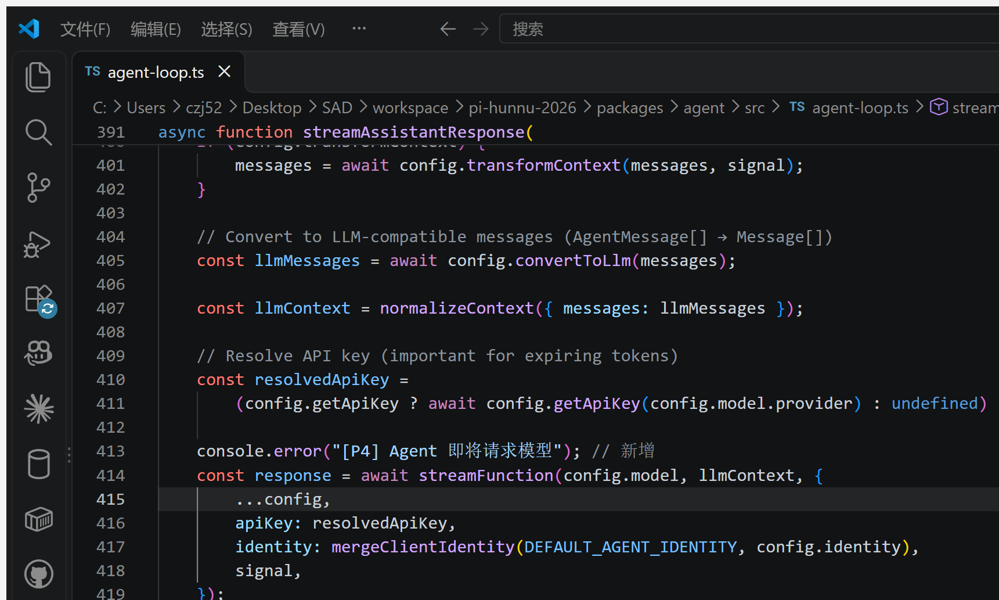
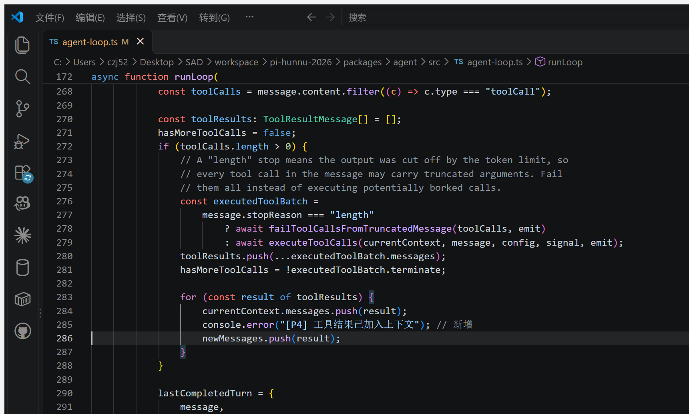
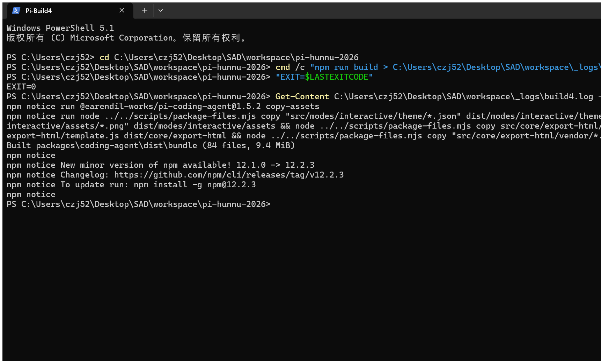
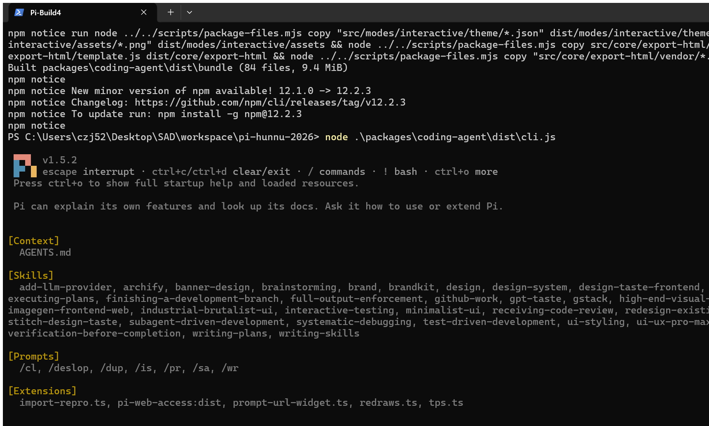
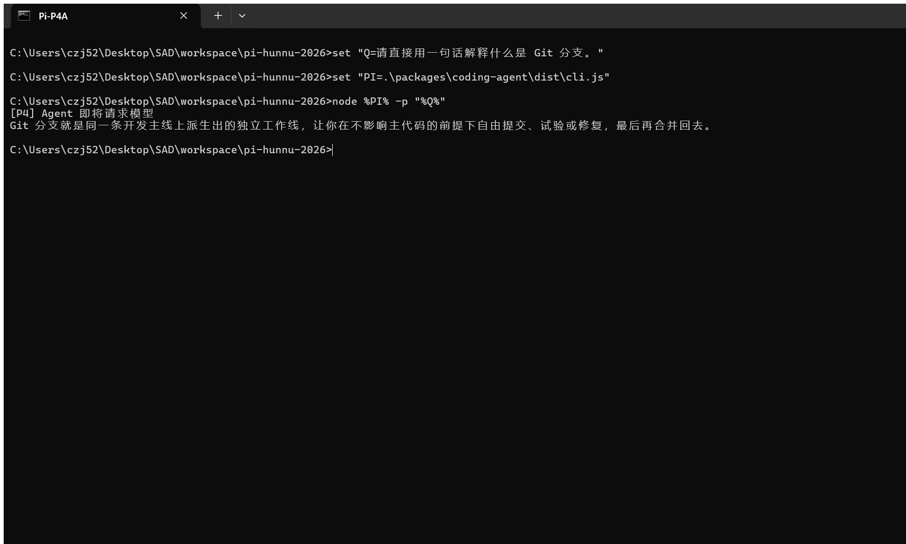
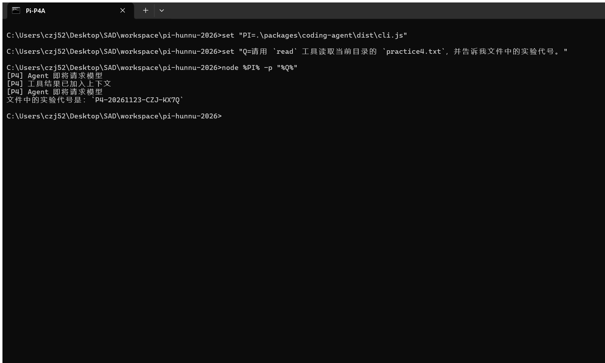
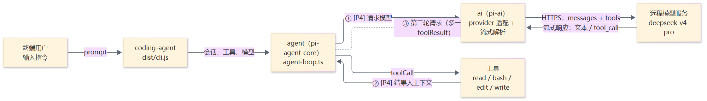
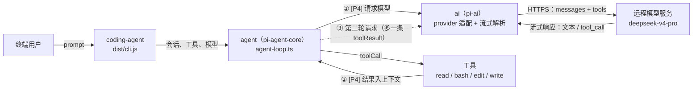

# 实践课4：Pi Agent 的模型调用与运行流程

- 姓名：陈智杰　GitHub：[@czj-daniel-knox](https://github.com/czj-daniel-knox)
- 小组组织仓库：<https://github.com/SAD-OpenStudy/pi-hunnu-2026>
- 源码版本：`c3cc91632d0a1950fb122605b190233f2aa0006e`（`main`）
- 本地路径：`C:\Users\czj52\Desktop\SAD\workspace\pi-hunnu-2026`
- 构建产物版本：`1.5.2`　模型：`deepseek-v4-pro`（两次会话相同）
- 报告日期：2026-11-23

---

## 0 结论速览

| 问题 | 观察结果 |
|---|---|
| 插桩位置 | `packages/agent/src/agent-loop.ts`：模型调用前（现第 413 行）、工具结果写入 `currentContext.messages` 后（现第 285 行） |
| 会话 A（直接问答） | 不调用工具，出现 **1 条** `[P4] Agent 即将请求模型`，进入 **1 轮**模型调用 |
| 会话 B（读取文件） | 调用 **1 次** `read` 工具，日志顺序为 **即将请求模型 → 工具结果已加入上下文 → 即将请求模型**，进入 **2 轮**模型调用 |
| 谁读了文件 | 本地 `read` 工具（由 `agent` 进程执行），**不是**远程模型；模型只发出 `toolCall`，拿到工具结果后才“知道”文件内容 |
| 下一轮多带了什么 | 上下文中多了一条 `toolResult` 消息（`practice4.txt` 的内容 `P4-20261123-CZJ-KX7Q`），以及上一轮带 `toolCall` 的 assistant 消息 |
| 读到的代号 | `P4-20261123-CZJ-KX7Q`（与 `practice4.txt` 一致） |

---

## 1 任务一：给 Agent 循环加两行日志

### 1.1 模型调用前打印（原第 412 行）

在 `const response = await streamFunction(...)` **上方**插入日志：

```ts
	console.error("[P4] Agent 即将请求模型"); // 新增
	const response = await streamFunction(config.model, llmContext, {
		...config,
		apiKey: resolvedApiKey,
		identity: mergeClientIdentity(DEFAULT_AGENT_IDENTITY, config.identity),
		signal,
	});
```



*图1　S1：编辑器内 `agent-loop.ts` 文件名与行号可见；第 413 行为新增日志，第 414 行是 `await streamFunction(config.model, llmContext, {`。*

### 1.2 工具结果进入上下文后打印（原第 284 行）

在 `for (const result of toolResults)` 循环里、`currentContext.messages.push(result);` **下方**插入日志：

```ts
				for (const result of toolResults) {
					currentContext.messages.push(result);
					console.error("[P4] 工具结果已加入上下文"); // 新增
					newMessages.push(result);
				}
```



*图2　S2：第 283 行 `for (const result of toolResults) {`、第 284 行 `currentContext.messages.push(result);`、第 285 行新增日志、第 286 行 `newMessages.push(result);`。*

### 1.3 代码差异

```diff
@@ -282,6 +282,7 @@ async function runLoop(
 				for (const result of toolResults) {
 					currentContext.messages.push(result);
+					console.error("[P4] 工具结果已加入上下文"); // 新增
 					newMessages.push(result);
 				}
 			}
@@ -409,6 +410,7 @@ async function streamAssistantResponse(
 	const resolvedApiKey =
 		(config.getApiKey ? await config.getApiKey(config.model.provider) : undefined) || config.apiKey;
 
+	console.error("[P4] Agent 即将请求模型"); // 新增
 	const response = await streamFunction(config.model, llmContext, {
 		...config,
 		apiKey: resolvedApiKey,
```

两个插入点都是纯 `console.error`，不改动任何状态与参数：日志写 stderr，不进入模型上下文，也不影响工具执行。工作区状态：`M packages/agent/src/agent-loop.ts`、`?? practice4.txt`。

---

## 2 任务二：重新编译并启动

### 2.1 重新构建（S3）

```powershell
cd C:\Users\czj52\Desktop\SAD\workspace\pi-hunnu-2026
cmd /c "npm run build > C:\Users\czj52\Desktop\SAD\workspace\_logs\build4.log 2>&1"
"EXIT=$LASTEXITCODE"
```



*图3　S3：项目根目录执行 `npm run build`，命令返回提示符后 `"EXIT=$LASTEXITCODE"` 输出 `EXIT=0`；下方是构建日志最后 8 行，包含 `Built packages\coding-agent\dist\bundle (84 files, 9.4 MiB)`。*

构建输出重定向到日志文件，是因为 11 个包的日志（含 `ai` 的模型目录）有几百行，全量打印会淹没终端；日志的**末尾**与退出码在同一屏内展示，能同时证明“构建跑完”“没有报错”。本次 11 个包全部重建，耗时约 1 分 51 秒（18:44:45 → 18:46:36）。

### 2.2 启动编译产物（S4）

```powershell
node .\packages\coding-agent\dist\cli.js
```



*图4　S4：先看到输入的命令，随后是 Pi 交互界面的启动信息（`v1.5.2`、`[Context] AGENTS.md`、`[Skills]`、`[Prompts]`、`[Extensions]`）。*

启动后界面里的 `fd`/`ripgrep` 下载失败警告与 `Update Available` 提示都是环境提示，不影响本次实验；模型与凭据沿用 `~/.pi/agent` 的配置。

---

## 3 任务三：两次会话对比

实验文件放在项目根目录，内容为一行的自定代号：

```powershell
PS> Get-Content practice4.txt
P4-20261123-CZJ-KX7Q
```

两次会话都用同一个编译产物、同一个模型（`deepseek-v4-pro`），各自是**新会话**（`-p` 不带 `--continue`）。

### 3.1 会话 A：直接问答

```powershell
set "PI=.\packages\coding-agent\dist\cli.js"
set "Q=请直接用一句话解释什么是 Git 分支。"
node %PI% -p "%Q%"
```



*图5　S5：请求提示词、实际出现的 `[P4]` 日志与实际回复。*

实际记录：

| 项 | 内容 |
|---|---|
| 输入指令 | 请直接用一句话解释什么是 Git 分支。 |
| 工具调用 | 无 |
| `[P4]` 日志（按顺序） | `[P4] Agent 即将请求模型`（1 条） |
| 最终回复 | Git 分支就是同一条开发主线上派生出的独立工作线，让你在不影响主代码的前提下自由提交、试验或修复，最后再合并回去。 |
| 模型调用轮数 | **1 轮** |

日志只有一条，说明这类问题不需要工具：`agent-loop` 组好 `llmContext` 后直接请求模型，模型返回文本就结束，`for (const result of toolResults)` 这一段没有执行。

### 3.2 会话 B：用 `read` 读文件

```powershell
set "PI=.\packages\coding-agent\dist\cli.js"
set "Q=请用 `read` 工具读取当前目录的 `practice4.txt`，并告诉我文件中的实验代号。"
node %PI% -p "%Q%"
```



*图6　S6：请求提示词、`read` 工具执行后的 `[P4] 工具结果已加入上下文`、第二次请求日志，以及最终回复的代号。*

实际记录：

| 项 | 内容 |
|---|---|
| 输入指令 | 请用 `read` 工具读取当前目录的 `practice4.txt`，并告诉我文件中的实验代号。 |
| 工具调用 | `read`（参数 `path: practice4.txt`），成功读到文件内容 |
| `[P4]` 日志（按顺序） | `[P4] Agent 即将请求模型`<br>`[P4] 工具结果已加入上下文`<br>`[P4] Agent 即将请求模型` |
| 最终回复 | 文件中的实验代号是：`P4-20261123-CZJ-KX7Q` |
| 模型调用轮数 | **2 轮** |

Pi 自己的会话文件（`~/.pi/agent/sessions/...`）也记下了这次工具调用，可与日志互相印证：

```text
用户: 请用 `read` 工具读取当前目录的 `practice4.txt`，并告诉我文件中的实验代号。
toolCall:   name=read  args={"path":"practice4.txt","offset":null,"limit":null}
toolResult: name=read  content="P4-20261123-CZJ-KX7Q"
assistant:  文件中的实验代号是：`P4-20261123-CZJ-KX7Q`
```

### 3.3 两次对比

| 对比项 | A：直接问答 | B：读取文件 |
|---|---|---|
| 是否调用工具 | 否 | 是，调用 1 次 `read` |
| `[P4] Agent 即将请求模型` | 1 条 | 2 条 |
| `[P4] 工具结果已加入上下文` | 0 条 | 1 条 |
| 模型调用轮数 | 1 轮 | 2 轮 |
| 前后两轮之间多了什么 | — | 一条 `toolResult` 消息（文件内容） |
| 回复来源 | 模型自身知识 | 工具读到的文件内容 |

---

## 4 运行流程：日志说明了什么

### 4.1 两类日志对应的代码位置

- `[P4] Agent 即将请求模型` 打在 `streamAssistantResponse()` 里、`await streamFunction(...)` 之前。每进入一次“把当前上下文交给模型”的动作就会打一条，所以**它的条数就是模型调用轮数**。
- `[P4] 工具结果已加入上下文` 打在 `runLoop()` 的 `for (const result of toolResults)` 里、`currentContext.messages.push(result)` 之后。每把一条工具结果写入上下文就打一条，所以**它的条数就是本轮写入上下文的工具结果条数**。

会话 B 的三条日志正好描述循环的后半段：

```text
[P4] Agent 即将请求模型          ← 第 1 轮：把用户问题交给模型
[P4] 工具结果已加入上下文        ← 模型返回 toolCall，agent 执行 read，把结果写进 currentContext.messages
[P4] Agent 即将请求模型          ← 第 2 轮：带着刚写入的 toolResult 再请求模型
```

### 4.2 谁实际读了文件

读文件的是**本地的 `read` 工具**，由 `agent` 进程在 `executeToolCalls()` 阶段执行；远程模型只做了一件事：返回一个 `toolCall`（`{"path":"practice4.txt"}`）。模型在发出这个 `toolCall` 时并不知道文件内容——它是在第 2 轮请求里才拿到工具结果，所以**没有那第二次请求，模型不可能说出代号**。这也是为什么会话 B 的日志里一定夹着一条“工具结果已加入上下文”。

### 4.3 下一轮模型请求多带了什么

对比 B 的第 1 轮与第 2 轮，`llmContext.messages` 多了两部分：

1. 上一轮的 assistant 消息，其中包含 `toolCall`（`name=read`, `arguments={"path":"practice4.txt"}`）；
2. 一条 `toolResult` 消息，`toolName=read`，内容就是 `practice4.txt` 的文本 `P4-20261123-CZJ-KX7Q`。

工具结果只通过 `currentContext.messages.push(result)` 这一行进入上下文，正好是第二处插桩的位置。

### 4.4 简图



*图7　实线为一次请求/响应的流向；① ② ③ 是本次插桩的两类日志所在位置。会话 A 只走 ① → ai → 远程模型 → 回复；会话 B 走 ① → 工具 → ② → ③ 再请求一次。*



图源：[`diagrams/flow.mmd`](diagrams/flow.mmd)。

分层职责与这三条日志的对应关系：

- `coding-agent`：把命令行参数变成一次会话，注册内置工具，启动交互界面或 `-p` 模式；
- `agent`：真正跑循环的地方——组 `llmContext`、调 `streamFunction`（①）、执行 `toolCall`、把结果写回上下文（②）、再循环（③）；
- `ai`：把统一请求翻译成某个 provider 的 HTTP 调用，解析流式响应与 tool call；
- 远程模型服务：只负责推理并返回文本或 `tool_call`，不接触本地文件系统。

---

## 5 环境与说明

- 本次使用的构建产物是 `packages/coding-agent/dist/cli.js`（`tsc -p tsconfig.build.json` 的直接输出），不是 `dist/bundle/cli.js`，与作业给的启动命令一致。
- **关于 S5/S6 的运行方式**：`node .\packages\coding-agent\dist\cli.js` 打开的是全屏 TUI（S4）。TUI 使用备用屏并持续重绘，`console.error` 写到 stderr 的日志会被界面覆盖，本机终端在这台机器上还出现了重绘后画面不刷新的情况，无法稳定截到日志顺序。因此两次会话改用**同一个编译产物**的非交互模式（`-p`，每次都是新会话、同一模型）运行：agent 循环、工具执行、`ai` 调用与 TUI 完全同一条代码路径，只是渲染层不同，日志顺序可以完整保留。
- 会话用 Windows 的 `cmd` 控制台运行，是因为 Windows PowerShell 5.1 会把原生 stderr 包装成 `NativeCommandError` 错误记录，混进日志文本；`cmd` 不做这层包装，`[P4]` 行保持原样。
- 终端字体缩小过（Ctrl+-），目的是让 147 列的缓冲区完整显示在一屏内，避免长回复被窗口右边界裁掉。
- 模型与鉴权沿用 `~/.pi/agent` 的已有配置；报告不包含任何凭据或授权信息。

---

## 6 附录

### 6.1 截图索引

| 文件 | 内容 | 要求 |
|---|---|---|
| `images/P4_S1_log_model.png` | 第 413 行模型请求日志 + 下方 `await streamFunction` | S1 |
| `images/P4_S2_log_tool.png` | 第 283–286 行 for 循环、push 与工具结果日志 | S2 |
| `images/P4_S3_build.png` | `npm run build`、回到提示符、`EXIT=0`、构建日志末尾 | S3 |
| `images/P4_S4_start.png` | `node .\packages\coding-agent\dist\cli.js` 命令 + Pi 界面 | S4 |
| `images/P4_S5_sessionA.png` | 会话 A 指令、1 条 `[P4]` 日志、回复 | S5 |
| `images/P4_S6_sessionB.png` | 会话 B 指令、3 条 `[P4]` 日志、回复代号 | S6 |
| `images/flow.png` | 四层运行流程简图 | 报告要求 |
| `diagrams/flow.mmd` | 简图图源（Mermaid） | — |

### 6.2 复现命令

```powershell
# 1. 插桩后重新构建
cd C:\Users\czj52\Desktop\SAD\workspace\pi-hunnu-2026
npm run build

# 2. 交互界面（S4）
node .\packages\coding-agent\dist\cli.js

# 3. 会话 A（cmd 控制台）
set "PI=.\packages\coding-agent\dist\cli.js"
set "Q=请直接用一句话解释什么是 Git 分支。"
node %PI% -p "%Q%"

# 4. 会话 B（cmd 控制台）
set "Q=请用 `read` 工具读取当前目录的 `practice4.txt`，并告诉我文件中的实验代号。"
node %PI% -p "%Q%"
```

### 6.3 环境

| 项 | 值 |
|---|---|
| Node.js / npm | v24.18.0 / 12.1.0 |
| 构建产物版本 | 1.5.2 |
| 模型 | deepseek-v4-pro（两次会话相同） |
| 源码提交 | c3cc91632d0a1950fb122605b190233f2aa0006e |
| 修改文件 | `packages/agent/src/agent-loop.ts`（+2 行） |
| 新增文件 | `practice4.txt`（1 行，`P4-20261123-CZJ-KX7Q`） |
