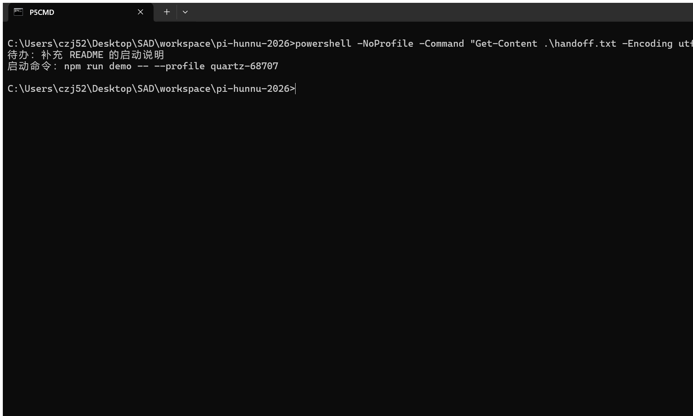
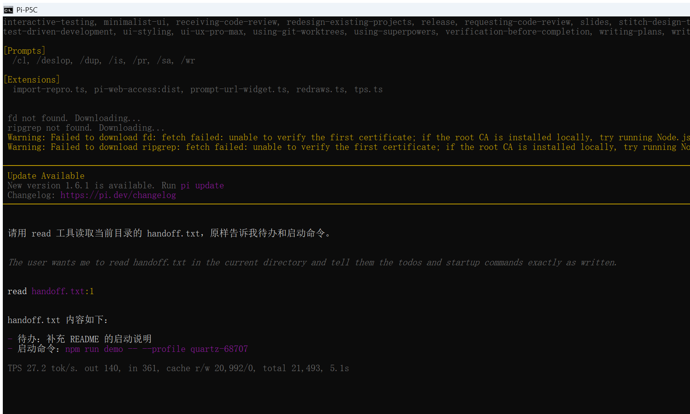
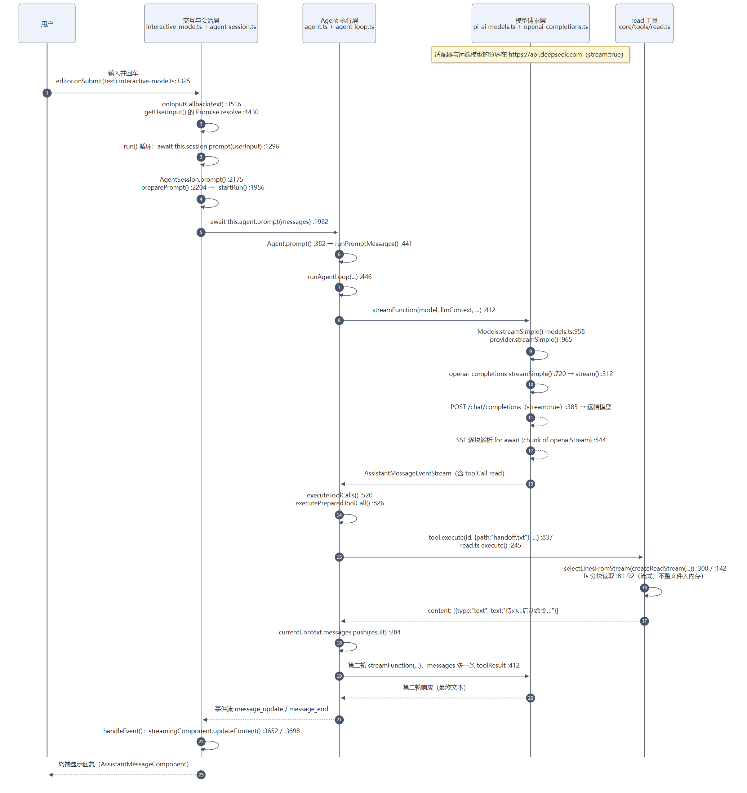
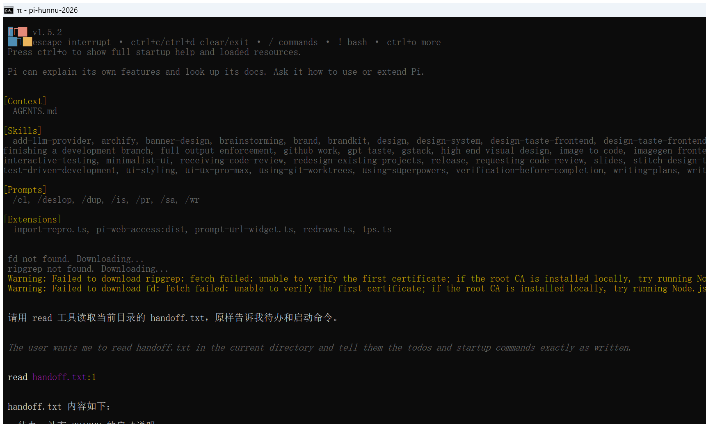
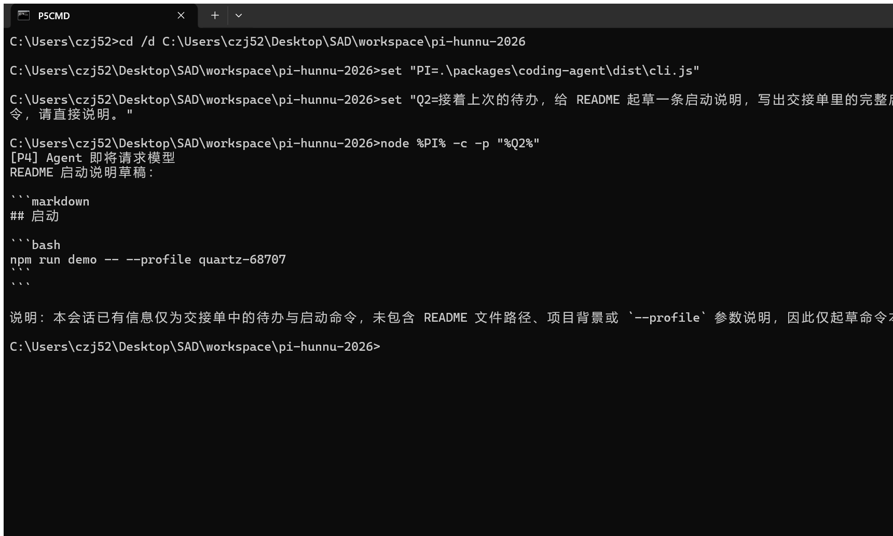
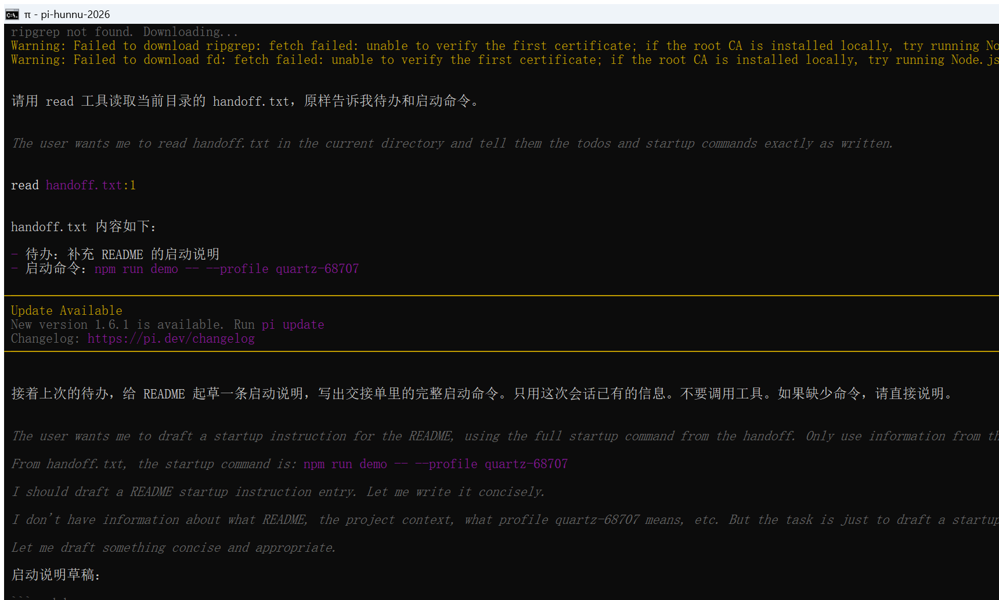
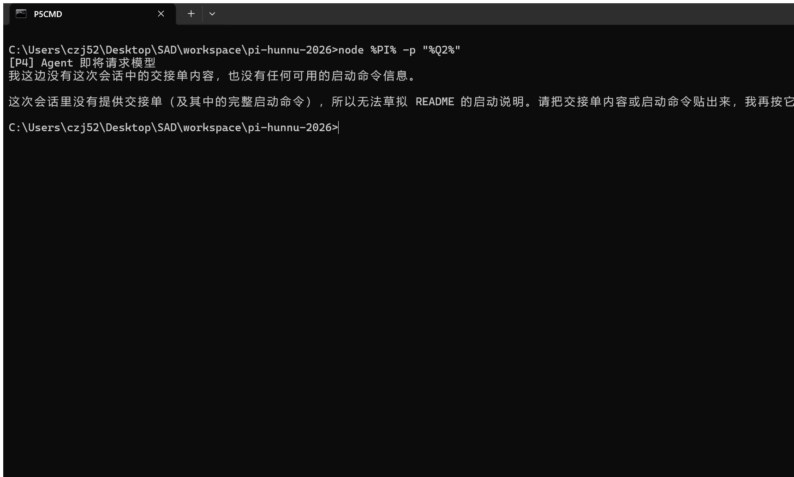
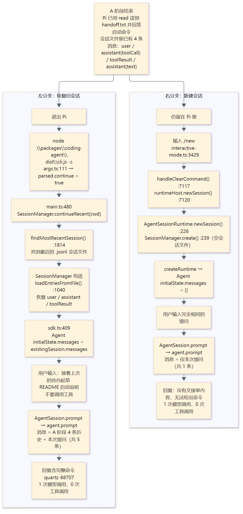

# 实践课5：Pi Agent 工具调用与会话恢复

- 姓名：陈智杰　GitHub：[@czj-daniel-knox](https://github.com/czj-daniel-knox)
- 小组组织仓库：<https://github.com/SAD-OpenStudy/pi-hunnu-2026>
- 源码版本：`c3cc91632d0a1950fb122605b190233f2aa0006e`（`main`，本地构建 `1.5.2`）
- 本地路径：`C:\Users\czj52\Desktop\SAD\workspace\pi-hunnu-2026`
- 模型：`deepseek-v4-pro`（A、B 两次会话相同）
- 报告日期：2026-11-26

---

## 0 结论速览

| 阶段 | 提问 | 工具调用 | 模型调用 | 回复要点 |
|---|---|---|---|---|
| A 读取交接单 | 请用 read 工具读取 handoff.txt | **1 次 `read`** | **2 次** | 原样给出待办与启动命令 `npm run demo -- --profile quartz-68707` |
| B1 恢复旧会话（`-c`） | 接着上次的待办起草 README 启动说明，不调用工具 | 0 次 | **1 次** | 写出完整命令 `quartz-68707`，并说明其余信息会话里没有 |
| B2 新建会话 | 与 B1 完全相同的提问 | 0 次 | **1 次** | 明确说没有交接单内容，无法给出命令 |

一句话：**文件是本地 `read` 工具读的，不是模型读的**；`-c` 恢复会话后，Pi 把 A 阶段的 4 条历史消息和新提问一起发给模型，所以 B1 能写出命令；`/new` 的新会话历史为空，只有新提问，模型就“不知道”命令。

---

## 1 实验准备

项目根目录新建 `handoff.txt`，实验标识随机生成（提问中不透露）：

```text
待办：补充 README 的启动说明
启动命令：npm run demo -- --profile quartz-68707
```



*截图0　`Get-Content handoff.txt -Encoding utf8` 的输出，标识为 `quartz-68707`。*

A 阶段在新会话输入：

```text
请用 read 工具读取当前目录的 handoff.txt，原样告诉我待办和启动命令。
```

---

## 2 A 阶段：单轮交互中的工具调用

### 2.1 实际运行



*截图A　Pi 界面里的完整一轮：用户提问 → `read handoff.txt:1` → 回复“待办：补充 README 的启动说明 / 启动命令：npm run demo -- --profile quartz-68707”，底部是本次请求的 token 统计。*

观察结果：

- **工具调用 1 次**：`read`，参数 `{"path":"handoff.txt","offset":1,"limit":null}`；
- **模型调用 2 次**：第 1 次模型只返回 `toolCall`，第 2 次带着工具结果才返回最终文本（会话文件里对应 `assistant[toolCall] → toolResult → assistant[text]`）；
- 工具结果原样进入上下文，模型没有改写文件内容。

### 2.2 图1：代码级时序图



*图1　五条生命线：用户、交互与会话层、Agent 执行层、模型请求层、`read` 工具。箭头标注的是真实函数与行号；同一层里的跨文件调用用自调用表示。*

图源：[`diagrams/fig1-sequence.mmd`](diagrams/fig1-sequence.mmd)。

逐步对照代码：

| 步骤 | 代码位置 | 做了什么 |
|---|---|---|
| 输入入口 | `modes/interactive/interactive-mode.ts:3325` `defaultEditor.onSubmit = async (text) => {...}` | 回车后拿到输入文本；普通消息走到 `:3516` 的 `onInputCallback(text)` |
| 交给主循环 | 同文件 `:4430` `getUserInput()`；`:1296` `await this.session.prompt(userInput)` | `onInputCallback` 让 `getUserInput()` 的 Promise resolve，`run()` 的主循环调用会话的 `prompt` |
| 会话准备 | `core/agent-session.ts:2175` `prompt()` → `:2204` `_preparePrompt()` → `:1956` `_startRun()` | 跑 input hooks、展开模板、校验模型与鉴权，然后启动一次 run |
| 启动 Agent | `:1982` `await this.agent.prompt(messages)` | 把用户消息交给 Agent |
| Agent 循环 | `packages/agent/src/agent.ts:382` `prompt()` → `:441` `runPromptMessages()` → `:446` `runAgentLoop(...)`；`agent-loop.ts` 里进入 `runLoop` | 组 `llmContext`，进入“请求模型 → 执行工具 → 再请求”的循环 |
| 请求模型 | `agent-loop.ts:412` `const response = await streamFunction(config.model, llmContext, {...})` | 第一次请求模型；此处的 `streamFunction` 是 `core/sdk.ts:412` 注入的 |
| 适配器 | `core/sdk.ts:412` `streamFn: async (...) => modelRuntime.streamSimple(...)` → `packages/ai/src/models.ts:958` `streamSimple()` → `:965` `provider.streamSimple(...)` | 选 provider，解析鉴权 |
| 具体协议 | `packages/ai/src/api/openai-completions.ts:720` `streamSimple` → `:312` `stream` → `:385` `client.chat.completions.create(params, ...).withResponse()`，参数里 `stream: true`（`:818`） | 向 `https://api.deepseek.com` 发 HTTPS POST（模型请求层与远端模型的分界） |
| 读流 | 同文件 `:544` `for await (const chunk of openaiStream)` | 逐块解析 SSE，拼出文本与 `toolCall` |
| 执行工具 | `agent-loop.ts:520` `executeToolCalls()` → `:826` `executePreparedToolCall()` → `:837` `prepared.tool.execute(...)` | 按 assistant 消息里的 `toolCall` 调工具 |
| read 工具 | `core/tools/read.ts:245` `execute()` → `:301-308` 选择读取方式 | 文本文件走 `selectLinesFromStream` |
| 文件系统 | 同文件 `:142` `selectLinesFromStream()` + `:81-92` `readLocalFileChunks()`（`handle.createReadStream`） | **流式分块读**，只保留要展示的行 |
| 结果回填 | `agent-loop.ts:284` `currentContext.messages.push(result)` | 工具结果进入上下文，循环进入第二轮（`:412` 再请求一次） |
| 显示回复 | `interactive-mode.ts:3649` `case "message_update"` → `:3652` `streamingComponent.updateContent(..., true)`；`:3685` `case "message_end"` → `:3698` `updateContent(..., false)` | 流式刷新，`message_end` 后把最终消息定格在聊天区 |

### 2.3 `read` 工具到底是流式还是缓冲

源码给了两条路径，但默认走流式：

- `read.ts:68-73` 的 `defaultReadOperations` 同时提供 `readFile`（`fsReadFile`）和 `createReadStream`（`readLocalFileChunks`）；
- `read.ts:300-308` 先判断 `ops.createReadStream && isStreamableRange(offset, limit)`（`:122`，整数 offset/limit 即可）→ 是则 `selectLinesFromStream(...)`，否则才退回 `selectLinesFromBuffer(await ops.readFile(...))`；
- `selectLinesFromStream`（`:142`）边读边切行，只保留 `truncateHead` 可能展示的行（上限 2000 行 / 50KB），其余只计数，内存不随文件大小增长；
- 本次 `handoff.txt` 只有 2 行，`offset=1`、`limit=null` 满足流式条件，所以实际走的是 **`fs` 分块流式读取**，不是整文件缓冲。

图1 的 `read` 工具生命线上标的 `selectLinesFromStream(createReadStream(...))` 就是这条实际路径。

---

## 3 B 阶段：恢复旧会话 vs 新建会话

A 阶段结束后退出 Pi。B 的两个分支用同一模型、完全相同的提问：

```text
接着上次的待办，给 README 起草一条启动说明，写出交接单里的完整启动命令。只用这次会话已有的信息。不要调用工具。如果缺少命令，请直接说明。
```

### 3.1 恢复旧会话：`node .\packages\coding-agent\dist\cli.js -c`



*截图B1a　`-c` 启动后第一屏：A 阶段的提问、`read handoff.txt:1` 工具调用以及“handoff.txt 内容如下…”的回答都还在，说明历史是从会话文件恢复的。*

在恢复的会话里输入 B 的提问，得到：



*截图B1b　恢复会话的回复：`npm run demo -- --profile quartz-68707` 与说明文字。stderr 只有 1 条 `[P4] Agent 即将请求模型`，没有“工具结果已加入上下文”，说明本轮没有调用工具（`[P4]` 是实践 4 留下的插桩日志，只用于计数）。*

TUI 里同一问题的过程也留下了截图（思考文本里直接出现 “From handoff.txt, the startup command is: npm run demo -- --profile quartz-68707”，随后开始写草稿）：



*截图B1c　恢复会话的 TUI 画面：上方是 A 阶段的完整历史，下方是本次提问与模型思考，没有新的 `read` 调用。*

实际回复（会话文件原文）：

````text
README 启动说明草稿：

```markdown
## 启动

```bash
npm run demo -- --profile quartz-68707
```
```

说明：本会话已有信息仅为交接单中的待办与启动命令，未包含 README 文件路径、项目背景或 `--profile` 参数说明，因此仅起草命令本身。
````

### 3.2 新建会话：`/new`（等价的空会话）



*截图B2　新会话里相同的提问：只有 1 条“即将请求模型”，没有工具日志；回复明确说“我这边没有这次会话中的交接单内容，也没有任何可用的启动命令信息”。*

`/new` 在源码里就是“新建一个空会话”：

`interactive-mode.ts:3429`（`text === "/new"`）→ `:7117` `handleClearCommand()` → `:7120` `runtimeHost.newSession()` → `core/agent-session-runtime.ts:226` `newSession()` → `:239` `SessionManager.create(this.cwd, sessionDir)` → 重新 `createRuntime`，新 Agent 的 `initialState.messages` 为空。

本次因为终端渲染限制（见 §5），B2 用同一编译产物的新进程会话复现，走的同样是 `SessionManager.create` 建空会话这条路径。

### 3.3 图2：两条分支发给模型的消息



*图2　左：`-c` → 读最近的会话文件 → 恢复历史 → 历史 + 新提问一起请求模型；右：`/new` → 空会话 → 只有新提问。*

图源：[`diagrams/fig2-sessions.mmd`](diagrams/fig2-sessions.mmd)。

两边的消息组成（`system` 之外）：

| 分支 | 发给模型的聊天消息 | 条数 | 结果 |
|---|---|---|---|
| B1 恢复 | A 的 user 提问、A 的 assistant（含 `read` toolCall）、A 的 toolResult（handoff 内容）、A 的 assistant 回答、B1 的新提问 | 5 | 写出命令 |
| B2 新建 | 只有 B2 的新提问 | 1 | 说没有命令 |

会话文件可以直接印证这个差别。恢复后的会话文件条目：

```text
1 session            6 assistant [thinking, toolCall]
2 model_change       7 toolResult [text]        ← handoff.txt 内容
3 thinking_level     8 assistant [text]         ← A 的最终回答
4 system             9 user [text]              ← B1 提问
5 user [text]       10 assistant [thinking, text]
```

而 B2 的新会话文件只有 `session / model_change / thinking_level_change / system / user / assistant` 六条，没有任何 A 阶段的消息。

### 3.4 为什么 B1 不需要重新读文件

`-c` 的解析与加载路径：

1. `cli/args.ts:111-112`：`--continue` / `-c` → `parsed.continue = true`；
2. `main.ts:479-481`：`if (parsed.continue) return SessionManager.continueRecent(cwd, sessionDir);`
3. `core/session-manager.ts:1811` `continueRecent()` → `:1814` `findMostRecentSession(dir)` 找最近的 `.jsonl`；
4. SessionManager 构造时 `:1040` `loadEntriesFromFile(this.sessionFile)` 读回条目，`buildContextEntries()` 还原成消息；
5. `core/sdk.ts:409`：`messages: existingSession.messages` 放进 Agent 的初始状态。

因此 B1 的第一次请求天然带着 A 的 toolResult，模型不需要（也没有）再调用 `read`；`[P4]` 日志里只有 1 条“即将请求模型”、0 条“工具结果已加入上下文”，与这一点一致。

---

## 4 结论

1. **单轮交互不等于一次模型调用**：A 的一次提问触发了 2 次模型请求和 1 次工具执行，循环在 `agent-loop.ts` 里；“即将请求模型”日志的条数就是模型调用轮数。
2. **工具结果是怎么进入下一轮的**：`executeToolCalls` 执行 `read`（流式读文件），生成的 `ToolResultMessage` 被 `currentContext.messages.push(result)`（`agent-loop.ts:284`）写进上下文，然后循环再进 `streamAssistantResponse`，第二次请求就带上了文件内容。
3. **会话恢复恢复的是消息，不是“记忆”**：`-c` 只是把会话文件里的历史消息重新放进 Agent 的 `messages`，下一次请求把它们和新提问一起发给模型；模型本身无状态，B1 能写出命令完全依赖这些历史消息。
4. **新会话的隔离**：`/new` 创建一个空会话文件与空 `messages`，相同提问只能得到“没有信息”的回答——这正好反证了 B1 用的是恢复出来的历史。

---

## 5 环境与说明

- 构建产物：`packages/coding-agent/dist/cli.js`（`tsc -p tsconfig.build.json` 输出），版本 1.5.2；模型 `deepseek-v4-pro`。
- **终端渲染限制**：本机 Windows Terminal 与 conhost 在 Pi 全屏 TUI 跑完一轮后会出现画面停止刷新（进程与结果都正常，只是窗口停在中间帧）。因此：
  - A 阶段和 B1 的“历史可见”用 TUI 截图留证（首屏与完成帧能正常渲染）；
  - B1 的完整回复、B2 的对照回复用同一编译产物的 `-p` 非交互模式取证，保证输出完整、可读；
  - 两种方式的 agent 循环、工具执行、会话加载路径完全相同，只差渲染层。
- 构建产物里保留了实践 4 的两条 `[P4]` stderr 日志（模型请求前、工具结果入上下文后各一条）。本报告只把它们当作“模型调用 / 工具结果”的计数器使用，不代表本实践要求修改源码；源码工作区相对小组仓库仍是实践 4 留下的两行插桩与 `practice4.txt`、`handoff.txt` 两个未跟踪文件，没有提交到小组仓库。

---

## 6 附件

| 文件 | 内容 |
|---|---|
| `diagrams/fig1-sequence.mmd` | 图1 的 Mermaid 时序图源 |
| `diagrams/fig2-sessions.mmd` | 图2 的 Mermaid 流程图源 |
| `images/fig1-sequence.png` / `fig2-sessions.png` | 两张图的渲染结果 |
| `images/P5_handoff.png` | handoff.txt 内容 |
| `images/P5_A_tool.png` | A 阶段：read 调用与回答 |
| `images/P5_B1_history.png` | `-c` 恢复后的历史 |
| `images/P5_B1_tui_draft.png` | B1 在恢复会话中的思考与草稿 |
| `images/P5_B1_print.png` | B1 完整回复与 `[P4]` 计数 |
| `images/P5_B2_new.png` | B2 新会话回复与 `[P4]` 计数 |